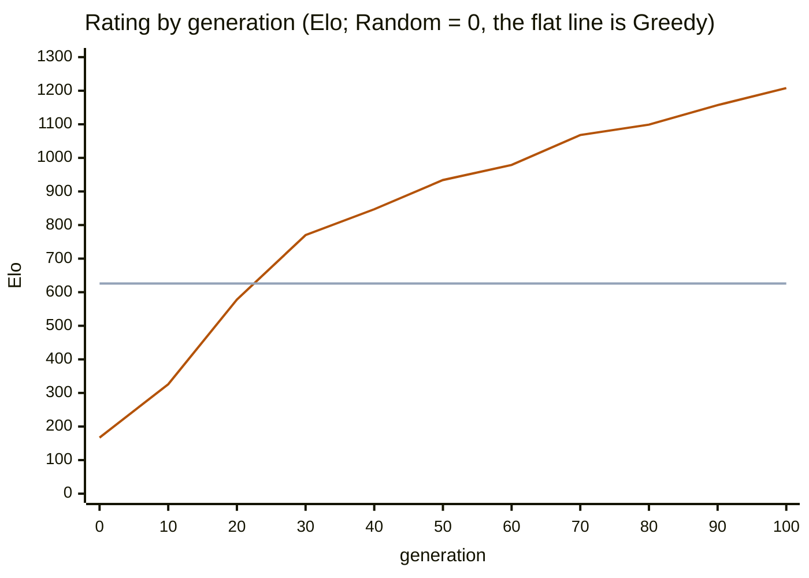
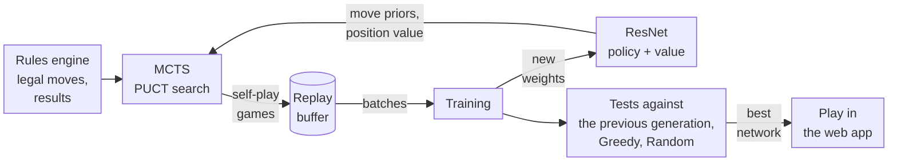

<div align="center">

# ChaturangZero

**An AlphaZero-style agent that learns Chaturanga, the ancient Indian ancestor of chess, from self-play alone.**


Course project for **CS F407 Artificial Intelligence**, BITS Pilani K. K. Birla Goa Campus · **Team Fable**

</div>

The agent is given nothing but the rules of the game. A residual neural network (policy and value
heads) guides a Monte Carlo Tree Search, and the agent improves by playing against itself. In 100
generations of self-play it went from random moves to winning every game against the Greedy
baseline, with no opening book and no hand-written evaluation.



| The Milestone 4 agent | `main-v4`, generation 100 |
|---|---|
| Strength | **1,208 Elo** (Random 0, Greedy 626, the untrained network 167) |
| Against Random and Greedy | won **40 of 40** against each |
| Network | 10 residual blocks × 128 filters, 3.5 million parameters |
| Training | 100 generations, 35,019 self-play games, about 57 hours on one GPU |
| Download | [release `milestone-4`](https://github.com/Aditya-00786/csf407-fable-chaturanga-zero/releases/tag/milestone-4) |

## Progress

| # | Milestone | Progress | Status |
|:-:|---|---|---|
| 1 | Rules engine, state/move encoding, unit tests | `██████████` 100% | Done |
| 2 | MCTS integrated with an untrained network | `██████████` 100% | Done |
| 3 | Self-play training pipeline (50–100 games, loss tracking) | `██████████` 100% | Done |
| 4 | Benchmarking vs random, heuristic and earlier agents | `█████████░`  95% | In progress |

```
Overall   ███████████████████████████████████████░  99%   (3 of 4 milestones done)
```

- **Milestone 3** went well past its 50 to 100 games: `main-v4` trained 100 generations and 35,019
  games ([the runs](docs/RUNS.md)).
- **Milestone 4** is all but done: a rating ladder gives the generations Elo ratings against
  Random, Greedy and each other, a conversion test measures how surely each turns a small edge into
  a win, and generation 100 is frozen as the agent ([benchmarking](docs/BENCHMARKING.md)). What
  remains is the data from people playing the agent: the app records those games, and teammates
  send theirs from their own laptops ([games against people](docs/HUMAN_GAMES.md)).
- **Also shipped:** a web app with a 3D board, three play modes, lessons, a rules reference and a
  Training page that runs and follows training on a Mac, Colab, Kaggle or your own server.

<details>
<summary>How to update the progress bars</summary>

Each bar is 10 characters for a milestone and 40 for the overall bar. Use `█` for done and `░` for
remaining, and update the percentage. Update the bars in the same commit that completes the work.

</details>

## How it works



1. **Search.** For each move the search looks ahead a few hundred positions, guided by the
   network's move suggestions and evaluations; finished games are scored exactly by the rules.
   ([How the agent thinks](docs/SEARCH.md))
2. **Self-play.** The newest network plays hundreds of games against itself. Every position becomes
   a lesson: the moves the search preferred, and how the game went. ([Training](docs/TRAINING.md))
3. **Learning.** The network trains on the newest games, and is tested against the generation before
   it and two fixed baselines. Then the loop repeats.
4. **Measuring.** A rating ladder and a conversion test track progress after the tests stop showing
   it. ([Benchmarking](docs/BENCHMARKING.md))

## Highlights

- **Researched ruleset.** Every rule is backed by historical sources, contested ones settled by
  counting references ([RULES.md](docs/RULES.md)); a reference move generator and a 10,000-game
  stress test check the engine.
- **AlphaZero's loop, scaled down.** PUCT search, a residual network, batched self-play on CPUs and
  a GPU, a replay buffer and AlphaZero's loss, with every generation tested, saved and resumable.
- **Search rules from Leela Chess Zero.** The agent takes every win in one, never allows one it can
  avoid, and plays on rather than repeat for a draw.
- **Honest measurement.** Losses on games the network has not seen, an Elo ladder with intervals for
  each step, and a conversion test calibrated on the agent's own generations.
- **Training anywhere.** On this Mac, Colab, Kaggle or your own server over SSH, followed live from
  the app, paused and resumed at any point.
- **A browser app.** A carved rosewood-and-brass 3D board in light and dark themes, a figural piece
  set after Indian court chess sets, play against four computer opponents, and 11 lessons.

## Quick start

```bash
git clone https://github.com/Aditya-00786/csf407-fable-chaturanga-zero.git
cd csf407-fable-chaturanga-zero
python3 -m venv .venv && source .venv/bin/activate
pip install -e ".[dev]"
python -m pytest -q                      # 284 passed
(cd web && npm install && npm run build)
python -m chaturanga_server              # then open http://127.0.0.1:8000
```

To play the trained agent, download its network from the
[`milestone-4` release](https://github.com/Aditya-00786/csf407-fable-chaturanga-zero/releases/tag/milestone-4),
save it as `checkpoints/best.pt`, and choose **Trained** as the opponent. More in
[Getting started](docs/GETTING_STARTED.md).

## Documentation

| Guide | What's in it |
|---|---|
| [Getting started](docs/GETTING_STARTED.md) | Setting up, every command, the engine's Python API |
| [How the agent thinks](docs/SEARCH.md) | The network, the search, the search's rules and contempt |
| [Training](docs/TRAINING.md) | The generation loop, runs, pausing, settings, the run report, sharing runs |
| [Training on servers and in the cloud](docs/TRAINING_REMOTE.md) | Your own server over SSH, Colab, Kaggle, CPUs and the GPU |
| [The training runs](docs/RUNS.md) | What each run taught us, and what the trained agent plays |
| [Benchmarking](docs/BENCHMARKING.md) | Milestone 4: the frozen agent, the rating ladder, the conversion test |
| [Games against people](docs/HUMAN_GAMES.md) | Recording games in the app, and collecting teammates' games |
| [The web app](docs/WEB_APP.md) | Screens, controls, accessibility, performance |
| [Architecture](docs/ARCHITECTURE.md) | How the code fits together, and the project's layout |
| [Rules](docs/RULES.md) | The full rules, with every source |
| [Contributing](docs/CONTRIBUTING.md) | Workflow, commit messages, conventions |

## The rules in brief

```
  8 | r n g k m g n r        K Raja (king)       1 step any direction, no castling
  7 | p p p p p p p p        M Mantri (minister) 1 step diagonally
  6 | . . . . . . . .        R Ratha (chariot)   like a rook
  5 | . . . . . . . .        G Gaja (elephant)   jumps exactly 2 squares diagonally
  4 | . . . . . . . .        N Ashva (horse)     like a knight
  3 | . . . . . . . .        P Padati (soldier)  1 step forward, captures diagonally,
  2 | P P P P P P P P                            no double step; promotes to Mantri
  1 | R N G M K G N R
      a b c d e f g h        Rajas do not face each other (e1 vs d8). White moves first.
```

| A game ends when… | Result |
|---|---|
| a side is left with only its Raja (bare king) | the other side wins at once |
| the side to move is checkmated | the checkmating side wins |
| the side to move has no legal move but is not in check (stalemate) | the **stalemated** side wins |
| the same position occurs 3 times | draw |
| 70 moves each pass with no capture and no Padati move | draw |
| 300 plies are played (an engineering cap) | draw |

## Project layout

```
chaturanga/          rules engine, network, search, self-play, training, benchmarks
chaturanga_server/   FastAPI server for the web app
web/                 browser app (React + Three.js)
scripts/             training, reports, benchmarks, runs on Kaggle and servers
tests/               284 tests
results/             each training run's metrics, charts and reports; games against people
docs/                these guides and the rules
```

Details in [Architecture](docs/ARCHITECTURE.md).

## Team

**Team Fable**, CS F407 Artificial Intelligence.

| Role | Responsibilities |
|---|---|
| Environment & Logic Engineer | Board logic, tensor encoding, legal move generation |
| Deep Learning & Pipeline Architect | ResNet model, training loop, replay buffer |
| Search Engine & Evaluation Specialist | MCTS / PUCT, evaluation suite, progress plots |

## References

- H. J. R. Murray, *A History of Chess*, Oxford, 1913. The main historical source for the rules.
- D. Silver et al., "A general reinforcement learning algorithm that masters chess, shogi, and Go
  through self-play", *Science* 362 (2018). The AlphaZero algorithm.
- Leela Chess Zero (lczero.org): proven results and contempt in the search.
- Full list of rule sources: [docs/RULES.md §1](docs/RULES.md#1-sources).
