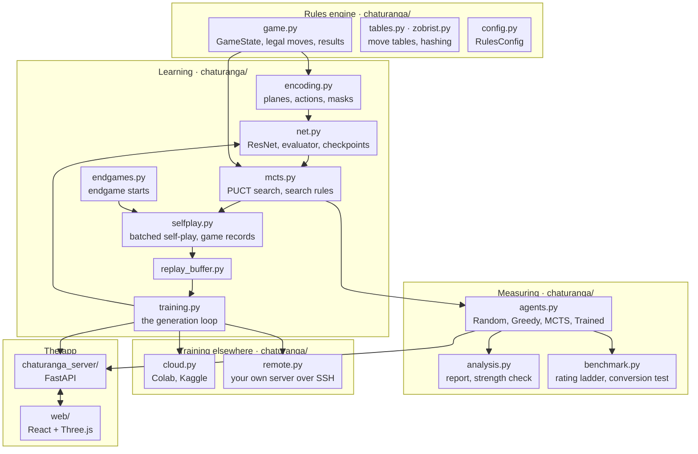
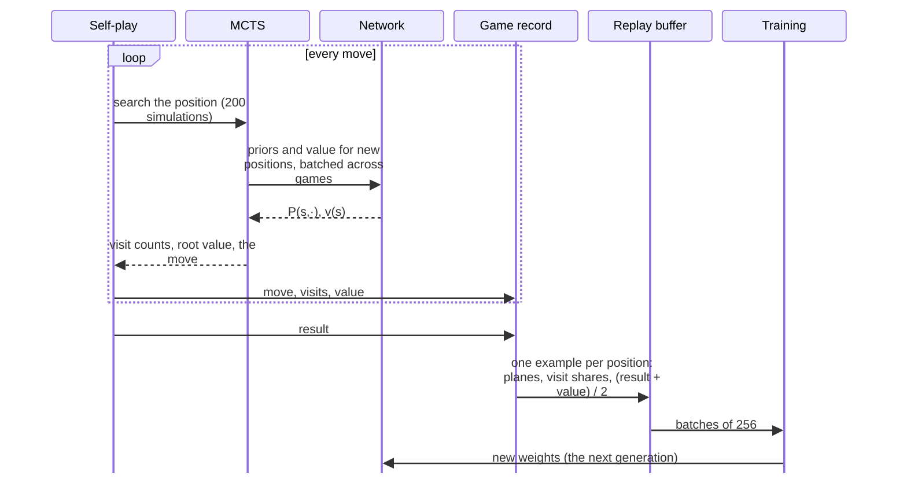

# Architecture

[← Back to the README](../README.md)

How the code is laid out, and how a position becomes a move and a game becomes training data.

## The parts and how they connect



## A game becomes training data



A game is stored as plain data (moves, visit counts, values and the result), about 40 KB a game,
and its training examples are rebuilt by replaying the moves. So a record is small, readable, and
a teammate's self-play games are just more records.

## Project structure

```
csf407-fable-chaturanga-zero/
├── chaturanga/              # rules engine and learning (Python package)
│   ├── config.py            # RulesConfig: rule options, defaults = docs/RULES.md
│   ├── constants.py         # piece codes, colours, square helpers
│   ├── tables.py            # precomputed move tables and attack detection
│   ├── zobrist.py           # position hashing for repetition detection
│   ├── game.py              # GameState: legal moves, apply(), outcome()
│   ├── encoding.py          # network input planes, action space, legal mask
│   ├── net.py               # policy-value ResNet, evaluator for MCTS, checkpoints
│   ├── mcts.py              # PUCT Monte Carlo Tree Search, the search's rules, contempt
│   ├── selfplay.py          # self-play games (batched across games), game records, training examples
│   ├── replay_buffer.py     # the most recent positions, sampled for training
│   ├── training.py          # the generation loop: self-play, train, test, checkpoint, pause, resume
│   ├── endgames.py          # random reduced-material starting positions for self-play
│   ├── analysis.py          # a run's report: findings, material probe, strength check
│   ├── benchmark.py         # Milestone 4: the rating ladder (Elo) and the conversion test
│   ├── cloud.py             # training on Colab (through Google Drive) and Kaggle (through its tool)
│   ├── remote.py            # training on your own server over SSH: connection, folder, copies
│   └── agents.py            # players: random, greedy (2-ply material), MCTS, trained (four levels)
├── chaturanga_server/       # FastAPI app used by the web client (stateless)
│   ├── app.py               # game and computer-move endpoints
│   ├── human_games.py       # games against people: checked, kept, added up, exported and imported
│   └── training_api.py      # training runs, reports and the ladder, for the Training page
├── web/                     # browser app (React + Three.js)
│   └── src/
│       ├── three/           # 3D board, procedural pieces, highlights, animation
│       ├── views/           # Play, Learn, Rules, Results, Training screens
│       ├── components/      # top bar, side panel, run report, charts, shared controls
│       ├── content/         # lessons.json (validated by tests/test_lessons.py)
│       ├── state/           # game and settings stores (Zustand)
│       └── lib/             # API client, piece data, notation, sounds
├── tests/                   # pytest suite (284 tests)
│   ├── reference.py         # independent, deliberately naive move generator
│   └── test_*.py            # engine, search, network, training, benchmarks, agents, API, games, lessons
├── scripts/
│   ├── random_play.py       # random-vs-random stress test and benchmark
│   ├── mcts_benchmark.py    # MCTS speed and matches against the baselines
│   ├── train.py             # self-play training
│   ├── selfplay.py          # self-play games for a teammate's run
│   ├── plot_training.py     # a run's loss and test curves
│   ├── report.py            # a run's report, strength check and ladder in a terminal (and for the app)
│   ├── kaggle_run.py        # a run on Kaggle: upload, start, follow, bring home
│   ├── server_run.py        # a run on your server: set up, start, follow live, pass pauses on
│   ├── server_job.py        # a server run's strength check or ladder, played there and followed
│   ├── share_runs.py        # a run's results for the repository, and an archive of it for a release
│   └── human_games.py       # the results of the games against people, as Markdown tables
├── results/                 # each run's settings, metrics, charts and reports, and human_games/
├── notebooks/
│   └── train_colab.ipynb    # the same training on Google Colab, saved to Drive
├── docs/                    # these guides, RULES.md and its source PDFs (Handouts/)
├── runs/, checkpoints/      # training runs and Play's network (git-ignored; shared as releases)
├── pyproject.toml           # package metadata and dependencies
├── PRODUCT.md               # product and design brief for the web app
└── README.md
```

## Design choices

| Choice | Why |
|---|---|
| Immutable `GameState` | a search tree holds many positions at once; `apply` returns a new one |
| The server replays the move list | the web app never implements the rules, and holds no state |
| Exact results for finished games | the network never has to judge a finished game |
| Batched evaluation across games | a GPU is fast on large batches; self-play and tests send many games' positions at once |
| Runs saved as plain files | a run stops and resumes anywhere, on any machine, and can be shared as an archive |
| Everything learned from the rules alone | no opening books, no hand-written evaluation (Greedy's piece values are only a baseline) |
