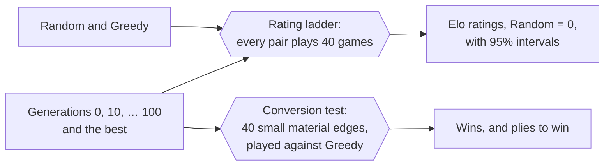
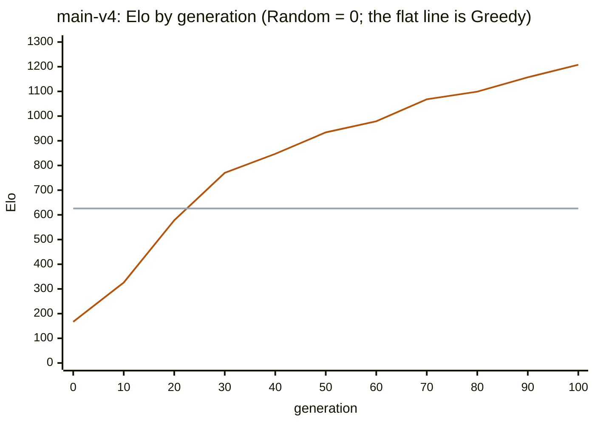
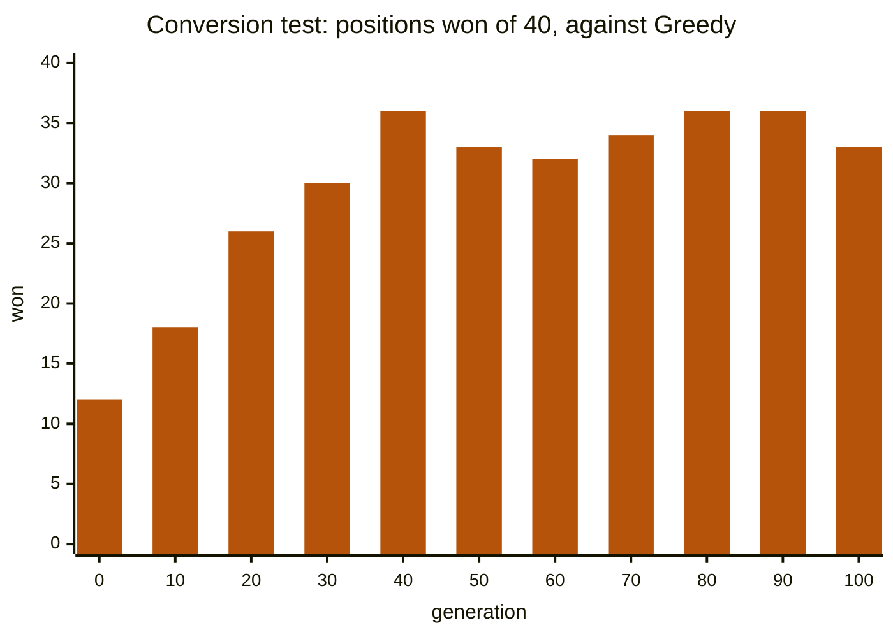
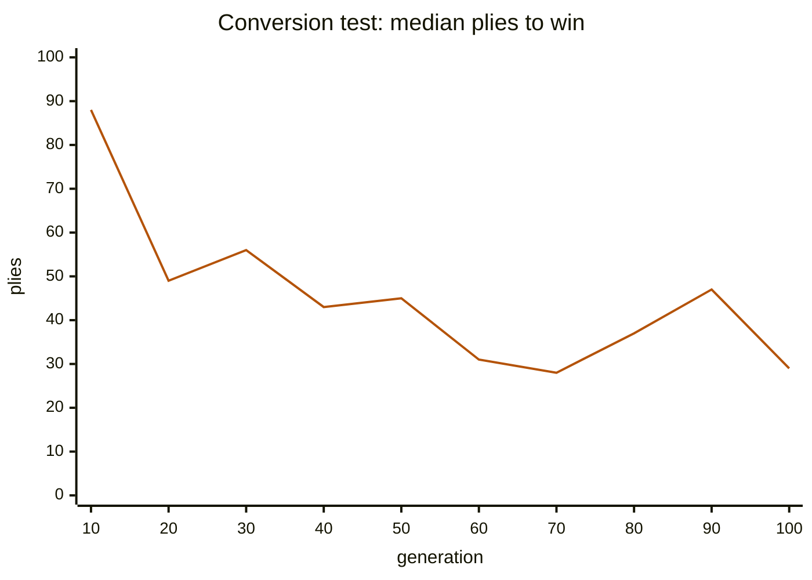

# Benchmarking (Milestone 4)

[← Back to the README](../README.md) · [The runs](RUNS.md)

Milestone 4 measures the agent against Random, Greedy (a 2-ply material search, the heuristic
baseline) and its own earlier generations. A run's own test games stop showing progress once it is
strong: against the generation before it scores about 50% by design, and Greedy, which it nearly
always beats, has little left to tell. Two yardsticks take over (`chaturanga/benchmark.py`):

Both are played from the Training page's Run report (**Rating ladder**, then **Rate
generations**), or with `python scripts/report.py --run <name> --ladder`. For a run trained on a
server, both play on that server.

Against people, the app records each game played against the computer, and teammates send theirs
from their own laptops: see [Games against people](HUMAN_GAMES.md).

## The Milestone 4 agent

Milestone 4's results describe one fixed agent, **`main-v4`'s generation 100**, frozen so that later
training cannot change what they refer to.

| | |
|---|---|
| Network | 10 residual blocks × 128 filters, 3,510,180 parameters |
| File | `chaturangzero-main-v4-gen100.pt` (14.1 MB) on the GitHub release [`milestone-4`](https://github.com/Aditya-00786/csf407-fable-chaturanga-zero/releases/tag/milestone-4); kept locally as `checkpoints/milestone4.pt` |
| SHA-256 | `49e88b164fa48e7266e9c66f752fde452c30a946d0f7a3853f5301ab48c8a5e3` |
| Training | 100 generations, 50,000 self-play games (7.8 million positions), about 57 hours on one server GPU |
| How it plays | Hard: 200 simulations a move, Impossible: 800; its most visited move, with the search's rules and contempt 0.3 |
| How it was measured | the ladder and the conversion test search 200 simulations with the rules and no contempt, the first 16 plies sampled |

| Result | |
|---|---|
| Rating ladder | **1,208 Elo** (1,103 to 1,313) with Random at 0; Greedy 626, generation 90 1,157, generation 60 979 |
| Against Random and Greedy | 40 / 0 / 0 against each on the ladder; 20 / 0 / 0 against each in the strength check |
| Against earlier generations (40 games each) | generation 90: 11 / 28 / 1 · 75: 20 / 20 / 0 · 60: 20 / 18 / 2 · 56: 21 / 18 / 1 |
| Conversion test | 33 of 40 won against Greedy, in 29 plies at the median |

> [!TIP]
> To play it: choose `main-v4`'s generation 100 in the Training page's In Play menu (it is pinned
> there), or put the release's file at `checkpoints/best.pt` (or point `CHATURANGA_CHECKPOINT` at
> it), then pick **Trained** at Hard or Impossible. Check a download with
> `shasum -a 256 chaturangzero-main-v4-gen100.pt`.

## The rating ladder

- **Who plays.** Every 10th generation (a setting), with the first, the latest and the best, and
  Random and Greedy. Each pair plays 40 games from the opening, colours alternating, searching as
  test games do.
- **Ratings.** Elo, fitted to every result at once (Bradley-Terry, a draw half a win), with Random
  at 0. One virtual draw per pair keeps a clean sweep's gap large but finite. If $R_i$ is player
  $i$'s rating, the expected score of $i$ against $j$ is

  $$E_{ij} = \frac{1}{1 + 10^{(R_j - R_i)/400}}$$

- **Uncertainty.** Each rating's 95% interval is against Random. Each step from one generation to
  the next has its own interval, much narrower, because neighbouring ratings move together.
- **Adding to it.** Rating later generations plays only their games against the rest, with the
  search the ladder began with, so the ratings stay comparable whatever the run's settings become.
  A run already on the ladder adds its new generations in its end-of-run report.

### main-v4 on the ladder

| Elo gained in each stretch | |
|---|---|
| Generations 0 → 30 | about +170 to +260 every 10 generations |
| 30 → 56 | about +80 every 10 |
| 56 → 60 | nothing measurable (+6, −40 to +53) |
| **60 → 70**: learning rate 1e-3 → 3e-4 | **+89** (+42 to +136) |
| 70 → 80 | +30 |
| 80 → 90: self-play at 400 simulations | +58 (+9 to +107) |
| 90 → 100: learning rate 1e-4, 200 simulations again | +51 (0 to +102) |

- **The run levelled off at generation 56, and a lower learning rate restarted it.** The tests
  against the generation before only hinted at this (51% in generations 51 to 60).
- **It passed Greedy between generations 20 and 30** (Greedy 626; generation 20, 578; generation 30,
  770). Generations 75 and 100 won all 40 of their games against it.
- **Strong networks draw each other**, mostly by repetition: between generations 70 and 100, 22 to
  32 of 40 games, 13 to 23 of them by repetition. Neither side finds a way through, which is where
  longer plans would show (see [contempt](SEARCH.md#the-searchs-rules)).

<b>Every rating, with its 95% interval</b>

| Player | Elo (95% interval) | Score | vs Greedy (W / D / L) |
|---|:-:|:-:|:-:|
| Generation 100 (the Milestone 4 agent) | 1,208 (1,103 to 1,313) | 84% | 40 / 0 / 0 |
| Generation 90 | 1,157 (1,053 to 1,261) | 79% | 37 / 2 / 1 |
| Generation 80 | 1,099 (995 to 1,202) | 74% | 38 / 1 / 1 |
| Generation 75 | 1,088 (985 to 1,192) | 73% | 40 / 0 / 0 |
| Generation 72 | 1,080 (977 to 1,183) | 72% | 34 / 4 / 2 |
| Generation 70 | 1,068 (965 to 1,171) | 71% | 36 / 3 / 1 |
| Generation 60 | 979 (876 to 1,081) | 61% | 34 / 6 / 0 |
| Generation 56 | 972 (870 to 1,075) | 61% | 36 / 2 / 2 |
| Generation 50 | 934 (832 to 1,036) | 57% | 30 / 8 / 2 |
| Generation 40 | 847 (745 to 948) | 48% | 31 / 7 / 2 |
| Generation 30 | 770 (668 to 871) | 41% | 23 / 6 / 11 |
| Greedy | 626 (525 to 726) | 30% | |
| Generation 20 | 578 (477 to 678) | 27% | 12 / 11 / 17 |
| Generation 10 | 326 (231 to 421) | 14% | 0 / 4 / 36 |
| Generation 0 (untrained) | 167 (76 to 257) | 7% | 0 / 4 / 36 |
| Random | 0 | 2% | 0 / 0 / 40 |

<b>Every step between rated generations</b>

| Step | Elo gained (95% interval) |
|---|:-:|
| Generation 0 to 10 | +159 (+80 to +238) |
| 10 to 20 | +252 (+180 to +324) |
| 20 to 30 | +192 (+135 to +249) |
| 30 to 40 | +77 (+27 to +127) |
| 40 to 50 | +88 (+40 to +135) |
| 50 to 56 | +38 (−8 to +85) |
| 56 to 60 | +6 (−40 to +53) |
| 60 to 70 | +89 (+42 to +136) |
| 70 to 72 | +12 (−35 to +60) |
| 72 to 75 | +8 (−39 to +56) |
| 75 to 80 | +10 (−37 to +58) |
| 80 to 90 | +58 (+9 to +107) |
| 90 to 100 | +51 (0 to +102) |

Ratings are refitted to every result each time players join, so they move a little (generation 60
rated 1,054 at first, 979 now); the steps are what to compare. The ladder's 5,400 games so far took
about 2 hours of the server's GPU in all.

## The conversion test

Forty positions in which one side is ahead in material by a small edge, eight of each:

| Side ahead | Side behind |
|---|---|
| Ashva + Padati | Ashva |
| Ratha + Padati | Ratha |
| Ratha + Ashva | Ratha |
| Ratha + Gaja | Ratha |
| Ratha + 2 Padatis | Ratha + Padati |

They are placed at random once, with a fixed seed: legal, the side ahead to move (White in half),
and no win in one. Each network plays the side ahead against Greedy, both playing their best moves.
Winning takes a plan: promote a Padati, bring two pieces together, and catch the last piece (a bare
Raja loses) without stalemating it (the stalemated side wins), all before 70 moves each pass without
a capture or a Padati move.

- **Converting a small edge improved until generation 40, then held** at 32 to 36 of 40, about as
  far apart as chance allows with 40 positions.
- **From generation 60 it finishes faster**: 27 to 31 plies at the median for generations 60 to 75,
  against 43 to 56 for 30 to 56. Generations 80 and 90, trained with the deeper self-play search,
  took a little longer; generation 100 is back at 29.
- Greedy playing the side ahead wins 14, and the untrained network 12 (losing 17, giving pieces
  away).

<b>Why these positions: the first version told nothing after generation 10</b>

The first version of the test used a large edge (a Ratha against a Padati, say), and every network
from generation 10 won 39 or 40 of its 40 positions. Fourteen balances were tried on the lab server,
12 positions each, with the untrained network, generations 10, 30 and 60 and Greedy playing the
side ahead. These five separated them best: generation 10 won at most 8 of 12 and generation 60 10
to 12, in about half the plies generation 30 needed.

| Player | Small edge (now): won | Median plies (mean) | Large edge (first test): won |
|---|:-:|:-:|:-:|
| Generation 0 (untrained) | 12 (17 lost) | 21 (40) | 24 |
| Generation 10 | 18 | 88 (85) | 40 |
| Generation 20 | 26 | 49 (64) | 40 |
| Generation 30 | 30 | 56 (68) | 39 |
| Generation 40 | 36 | 43 (58) | 40 |
| Generation 50 | 33 | 45 (58) | 40 |
| Generation 56 | 34 | 53 (55) | 40 |
| Generation 60 | 32 | 31 (35) | 39 |
| Generation 70 | 34 | 28 (51) | |
| Generation 72 | 36 | 30 (39) | |
| Generation 75 | 35 | 27 (42) | |
| Generation 80 | 36 | 37 (46) | |
| Generation 90 | 36 | 47 (47) | |
| Generation 100 | 33 | 29 (41) | |
| Greedy | 14 | 45 (63) | 28 |

## Tests

`tests/test_benchmark.py`: the Elo fit finds the ratings that made a set of results, keeps a clean
sweep finite and leaves unlinked players unrated; each step's interval is narrower than the two
ratings' together; the conversion positions are fixed, legal and one side ahead; the ladder rates
every entry and later plays only what is new, with the search it began with.
