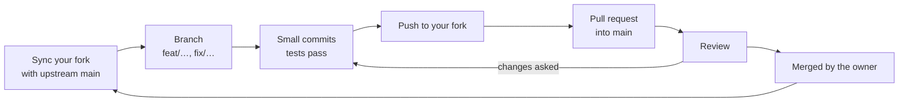

# Contributing

[← Back to the README](../README.md)

Changes reach `main` only through pull requests, and the repository owner reviews and merges every
one. Collaborators work in their own fork: **fork → branch → pull request**.



## Who can do what

Repository rulesets enforce this for every collaborator, present and future:

| | Collaborators | Owner |
|---|:-:|:-:|
| Fork, open and review pull requests, use issues | Yes | Yes |
| Create, push to or delete branches in this repository | No | Yes |
| Create or move tags, and releases | No | Yes |
| Merge pull requests into `main` | No | Yes |
| Force-push to or delete `main` | No | only in an emergency (bypass) |

## Step by step

1. **Sync your fork** so you branch from the latest `main` (or press **Sync fork** on GitHub):
   ```bash
   git checkout main
   git pull upstream main
   git push origin main
   ```
2. **Work on a branch**, never on `main`:
   ```bash
   git checkout -b feat/mcts-node-expansion
   ```
   Prefixes: `feat/`, `fix/`, `test/`, `docs/`, `refactor/`, `exp/` (experiments).
3. **Keep commits small and focused**, one logical change each.
4. **Before every commit:**

   | If you touched | Also run |
   |---|---|
   | anything | `python -m pytest -q` (all must pass) |
   | the engine | `python scripts/random_play.py --games 1000` |
   | the search or the network | `python scripts/mcts_benchmark.py --games 4` |
   | `web/` | `cd web && npx tsc -b && npx oxlint src` |

5. **Push the branch to your fork:**
   ```bash
   git push -u origin feat/mcts-node-expansion
   ```
6. **Open a pull request** into this repository's `main`, with GitHub's **Compare & pull request**
   button or:
   ```bash
   gh pr create --repo Aditya-00786/csf407-fable-chaturanga-zero --base main
   ```
   Describe what changed and how you tested it. To answer review comments, push more commits to the
   same branch.
7. **After it is merged**, delete the branch and sync your fork again.

> [!NOTE]
> The owner works from branches in this repository instead of a fork. Merging updates `main`, which
> the rulesets reserve, so a merge goes through the owner's bypass: on GitHub, **Merge without
> waiting for requirements to be met (bypass rules)**, or
> `gh pr merge <number> --merge --admin --delete-branch`.

## Commit messages

[Conventional Commits](https://www.conventionalcommits.org/):

```
<type>(<scope>): <short summary in the imperative, max ~72 chars>

<optional body: what changed and why, wrapped at ~72 chars>
```

| Type | Use for |
|---|---|
| `feat` | new functionality (`feat(mcts): add PUCT selection`) |
| `fix` | bug fixes (`fix(engine): reset no-progress counter on capture`) |
| `perf` | speed improvements |
| `test` | adding or changing tests only |
| `docs` | documentation |
| `refactor` | code changes that don't change behaviour |
| `chore` | tooling, dependencies, configuration |
| `exp` | training experiments and settings |

Scopes: `engine`, `encoding`, `mcts`, `net`, `train`, `eval`, `rules`, `scripts`, `server`, `web`.

## Conventions

- **Rule changes go through [RULES.md](RULES.md) first.** Add the source, update the reference
  tally, then change the code and tests in the same pull request.
- **Every bug fix comes with a test** that fails without the fix.
- **Match the surrounding code:** type hints on public functions, and short docstrings that explain
  *why* rather than *what*.
- **Never commit** virtual environments, training runs or checkpoints; `.gitignore` covers them.
  Runs are shared as GitHub releases (see [Sharing runs](TRAINING.md#sharing-runs)).
- **Keep the repository private:** [`docs/Handouts/`](Handouts/) holds copyrighted source PDFs.
