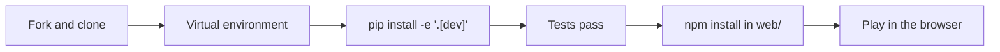

# Getting started

[← Back to the README](../README.md)

Set up the repository, run the tests and the app, and drive the engine from Python.



## Requirements

| Tool | Version | Notes |
|---|---|---|
| Python | 3.10 or newer | developed on 3.14 |
| Node.js | 20 or newer | only for the web app; developed on 24 |
| git | any recent | |
| PyTorch | installed with the package | runs on the CPU, or on CUDA or Apple's MPS when available |

## Setting up

1. **Fork, then clone your fork.** Collaborators can't push to this repository (see
   [Contributing](CONTRIBUTING.md)), so each of you works in your own fork. On GitHub, click
   **Fork**, then:
   ```bash
   git clone https://github.com/<your-username>/csf407-fable-chaturanga-zero.git
   cd csf407-fable-chaturanga-zero
   git remote add upstream https://github.com/Aditya-00786/csf407-fable-chaturanga-zero.git
   ```
   `origin` is your fork (you push there) and `upstream` is this repository (you pull from it). A
   fork of this private repository stays private; the owner clones it directly.
2. **Make a virtual environment**, which keeps the project's packages apart from the system's:
   ```bash
   python3 -m venv .venv
   source .venv/bin/activate          # Windows: .venv\Scripts\activate
   ```
3. **Install the package in editable mode**, so changes under `chaturanga/` apply without
   reinstalling:
   ```bash
   pip install -e ".[dev]"
   ```
4. **Check that everything works:**
   ```bash
   python -m pytest -q                # expect: 284 passed
   ```
5. **Install the web app's packages** (only for the browser app):
   ```bash
   cd web && npm install && cd ..
   ```

> [!TIP]
> The commands below assume the virtual environment is active. If it isn't, prefix them with
> `.venv/bin/` (for example `.venv/bin/python -m pytest`).

## Essential commands

<details open>
<summary><b>Tests</b></summary>

| Task | Command |
|---|---|
| Run all tests | `python -m pytest -q` |
| One test file | `python -m pytest tests/test_moves.py -v` |
| Tests matching a name | `python -m pytest -k stalemate -v` |
| Stop at the first failure | `python -m pytest -x` |
| Type-check and lint the web app | `cd web && npx tsc -b && npx oxlint src` |

</details>

<details>
<summary><b>Engine and search</b></summary>

| Task | Command |
|---|---|
| Random-play stress test (10,000 games) | `python scripts/random_play.py --games 10000` |
| Quick random-play benchmark (1 core) | `python scripts/random_play.py --games 200 --workers 1` |
| Random play with other rules | `python scripts/random_play.py --setup facing --promotion file` |
| MCTS speed only | `python scripts/mcts_benchmark.py --speed-only --threads 1` |
| Untrained MCTS vs Random and Greedy | `python scripts/mcts_benchmark.py --sims 50 --games 10 --threads 1` |
| A trained network vs Random and Greedy | `python scripts/mcts_benchmark.py --checkpoint checkpoints/best.pt --threads 1` |

`random_play.py` prints how the games ended, how long they were and how fast the engine ran. Every
move comes from the legal-move list and every game must end, so a crash or a hang means a bug.

</details>

<details>
<summary><b>Training</b> (see <a href="TRAINING.md">Training</a>)</summary>

| Task | Command |
|---|---|
| Train (20 generations of 50 games) | `python scripts/train.py` (Ctrl+C pauses) |
| Resume a paused or stopped run | `python scripts/train.py --run main` |
| Pause from another terminal | `python scripts/train.py --pause now` (or `after-phase`, `after-generation`; `--cancel-pause` withdraws it) |
| Train further | `python scripts/train.py --generations 40` |
| Search deeper in self-play, tests as before | `python scripts/train.py --generations 90 --sims 400 --eval-sims 200` |
| A quick test run | `python scripts/train.py --run quick --games 8 --generations 2 --eval-games 4` |
| Self-play games for a teammate's run | `python scripts/selfplay.py --checkpoint gen_0005.pt --games 50 --name <you>` |

</details>

<details>
<summary><b>Reports, benchmarks and sharing</b></summary>

| Task | Command |
|---|---|
| Plot a run's curves | `python scripts/plot_training.py` (needs `pip install -e ".[train]"`) |
| A run's report | `python scripts/report.py --run main` (add `--strength` for the strength check) |
| Rate a run's generations (Elo ladder, conversion test) | `python scripts/report.py --run main --ladder` |
| Share runs on GitHub | `python scripts/share_runs.py main-v4` (see [Sharing runs](TRAINING.md#sharing-runs)) |
| Results of the games against people | `python scripts/human_games.py` (see [Games against people](HUMAN_GAMES.md)) |

</details>

<details>
<summary><b>The app</b> (see <a href="WEB_APP.md">Web app</a>)</summary>

| Task | Command |
|---|---|
| Start the API server | `python -m chaturanga_server` (add `--reload` while developing) |
| Start the web dev server | `npm run dev --prefix web`, then open http://localhost:5173 |
| Build the web app | `npm run build --prefix web` |
| Serve the built app | `python -m chaturanga_server`, then open http://127.0.0.1:8000 |

</details>

## Using the engine from Python

```python
from chaturanga import GameState, move_to_str

s = GameState.initial()                 # standard starting position
print(s)                                # ASCII board
print([move_to_str(m) for m in s.legal_moves()])

s = s.play("e2e3").play("d7d6")         # moves are written from-square + to-square
print(s.outcome())                      # None while the game is in progress

s2 = GameState.from_fen("3k4/8/8/8/8/8/4R3/4K3 w")   # set up any position
print(s2.outcome())                     # Outcome(winner=1, reason='bare_king')
```

| Idea | In the code |
|---|---|
| Immutable states | `GameState` never changes: `apply(move)` and `play("e2e3")` return a new state, which is what a search tree needs |
| Moves are integers | `from_square * 64 + to_square`, with squares `a1 = 0 … h8 = 63` |
| Network input | `encoding.encode_state(state)`: 15×8×8 planes from the side to move's point of view |
| Legal moves for the network | `encoding.legal_action_mask(state)`: a 4,096-long mask; `move_to_action` and `action_to_move` convert |
| FEN letters | `K` Raja, `M` Mantri, `R` Ratha, `G` Gaja, `N` Ashva, `P` Padati; upper case is White |

To play the trained agent from Python: `make_agent("zero", level="hard")` from `chaturanga.agents`
(see [Playing the trained agent](TRAINING.md#playing-the-trained-agent)).
