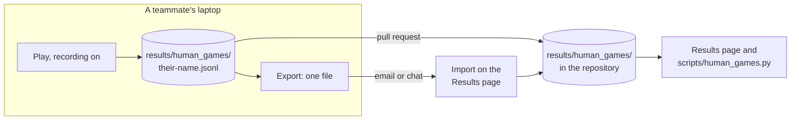

# Games against people

[← Back to the README](../README.md)

The proposal's last evaluation is the agent against people. Play records every game a person plays
against the computer, and the **Results** page adds them up by opponent and by player. Teammates
play on their own laptops and send their games as a file, or commit them in a pull request.



## Playing on your own laptop

1. **Set up the project** as [Getting started](GETTING_STARTED.md#setting-up) explains (steps 1
   to 3, and 5 for the web app).
2. **Start the app** in one server:
   ```bash
   npm run build --prefix web
   python -m chaturanga_server
   ```
   Then open http://127.0.0.1:8000.
3. **Load the Milestone 4 agent.** Networks are not in the repository, so a new clone has none.
   Open **Results**: it says the computer has no trained network and walks you through it. Download
   `chaturangzero-main-v4-gen100.pt` from the release
   [`milestone-4`](https://github.com/Aditya-00786/csf407-fable-chaturanga-zero/releases/tag/milestone-4)
   and choose the file with **Load network file**. The page then reads *Play's trained opponent
   is the Milestone 4 agent*, recognised by the file's sha256.

   From a terminal instead (needs the GitHub CLI; the running app picks the file up by itself):
   ```bash
   mkdir -p checkpoints
   gh release download milestone-4 -p chaturangzero-main-v4-gen100.pt -O checkpoints/best.pt
   ```
4. **Play with recording on.** In **Play**, open the **Game** panel and choose **Vs computer**,
   **Trained** and a level. Under **Recording**, switch on **Record my games** and enter your name.
   Each game is saved when it ends, and the card at the end says so.
5. **Send your games** in one of two ways:
   - **As a file:** **Results**, then **Export games**. Send the downloaded
     `chaturangzero-games-<your-name>-<date>.json` by email or chat.
   - **In a pull request:** your games are in `results/human_games/<your-name>.jsonl`, a file of
     your own, so it never clashes with anyone else's. Following [Contributing](CONTRIBUTING.md):
     ```bash
     git switch -c games/<your-name>
     git add results/human_games/<your-name>.jsonl
     git commit -m "exp(eval): <your name>'s games against the Milestone 4 agent"
     git push -u origin games/<your-name>
     ```
     Then open a pull request into `main`.

> [!TIP]
> Play several games at the level you choose, and finish them: a game you leave for a new one
> counts as resigned. The levels are Easy, Medium, Hard and Impossible; Hard and Impossible always
> play their best move ([the levels](SEARCH.md#the-searchs-rules)).

## Collecting everyone's games

On the laptop that collects them, open **Results**, choose **Import files** and pick the files
teammates sent (several at once is fine). Each game is replayed and checked again. A game that is
already there is skipped, so importing the same file twice does no harm. Then commit
`results/human_games/`.

For the docs, the same results as Markdown tables:

```bash
python scripts/human_games.py               # every opponent
python scripts/human_games.py --milestone   # the Milestone 4 agent only
```

## What counts

A game is recorded from its first move to its end, against one opponent, with the person playing
one colour throughout. While it is, the Game panel locks the mode, the colour, the opponent and its
level.

| What happens | How it is recorded |
|---|---|
| The game ends by the rules | the engine's result: checkmate, bare king, stalemate, or a draw |
| **Resign** (in the quick actions or the Game panel) | a loss, *resigned* |
| **New game** before the end | a loss, *left the game* |
| A new game before your first move | not recorded |
| **Undo** | allowed, and counted as take-backs |
| Recording switched on during a game | the next game is recorded |
| Replaying a game, or watching one from Training | the recorded game waits, and carries on after |
| Switching recording off during a game | that game is not recorded |
| Closing or reloading the page during a game | that game is lost |

Results are kept apart for each opponent, each level and each network. A network is known by its
file's sha256: the Milestone 4 agent's starts `49e88b16`. Games against a run's later networks never
mix with it.

## How games are checked

Nothing the app sends is taken on trust. The server (`chaturanga_server/human_games.py`) replays
every game from the start before keeping it:

- every move must be legal, and none can come after the game ended;
- a game *played out* must be over; one *resigned* or *left* must not be, and the person must have
  moved;
- the result comes from the engine, not from the app;
- on import, a game whose stated result differs from what its moves give is turned away, with the
  reason shown.

A game is known by the id the app gave it, so it is kept once however often it is sent.
`tests/test_human_games.py` covers recording, the checks, the results, importing and loading a
network file.

## The files

`results/human_games/<name>.jsonl` holds one game per line, in the order they finished. The name is
the player's name in lower case, letters and digits only (`Aditya Bhansali` is
`aditya-bhansali.jsonl`).

<details>
<summary><b>The fields of a game</b></summary>

| Field | What it is |
|---|---|
| `id` | the app's id for the game |
| `player` | the name the person entered |
| `human` | the colour the person played, `white` or `black` |
| `opponent`, `level` | `random`, `greedy`, `mcts` or `zero` (the trained agent), and its level |
| `network` | the trained agent's `run`, `generation` and `fingerprint` (sha256 of its file) |
| `network_changed` | true if Play's network changed during the game (a run publishing a new one) |
| `result`, `reason`, `winner` | `win`, `draw` or `loss` for the person; how it ended; `white`, `black` or null |
| `plies`, `moves` | the moves, from-square and to-square (`e2e3`) |
| `takebacks` | how many times the person used Undo |
| `started`, `finished` | UTC times |

An exported file wraps the games as `{"format": "chaturangzero-human-games", "version": 1,
"exported": …, "games": [...]}`. Import takes either kind of file.

</details>
