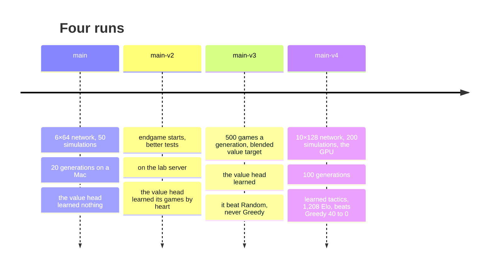
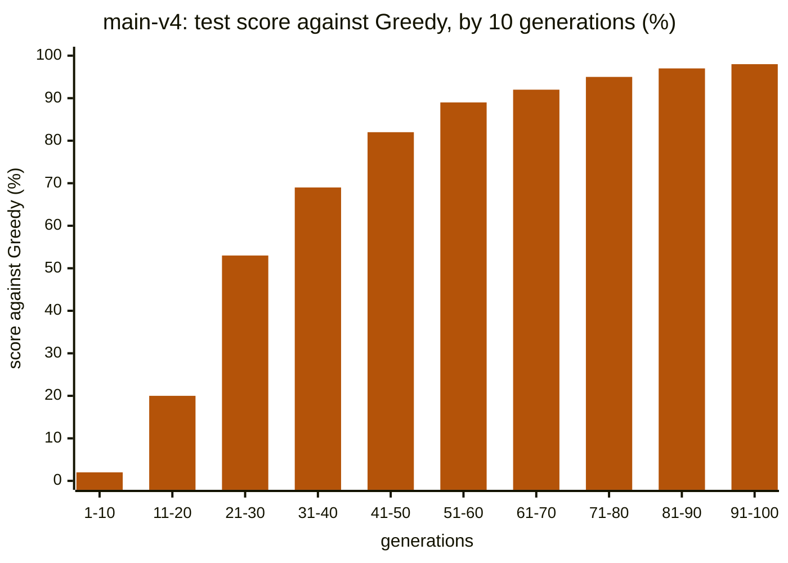
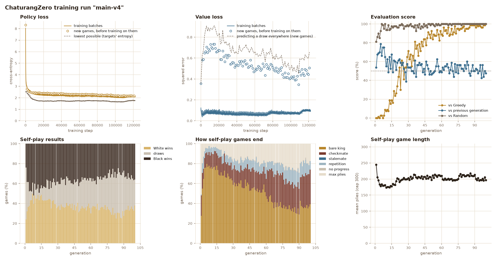
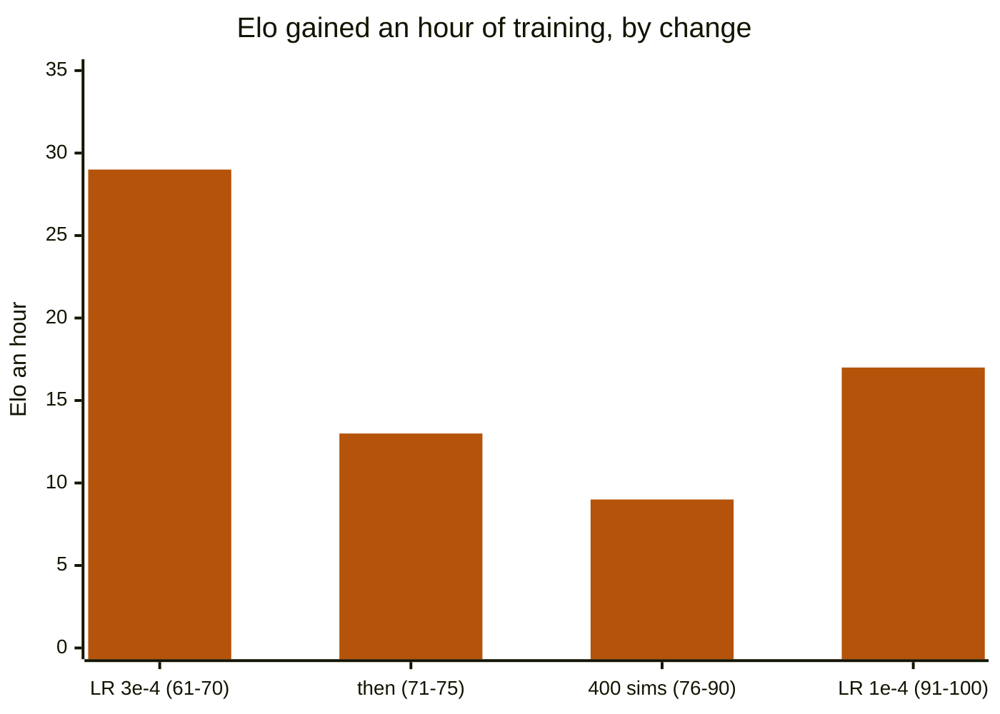
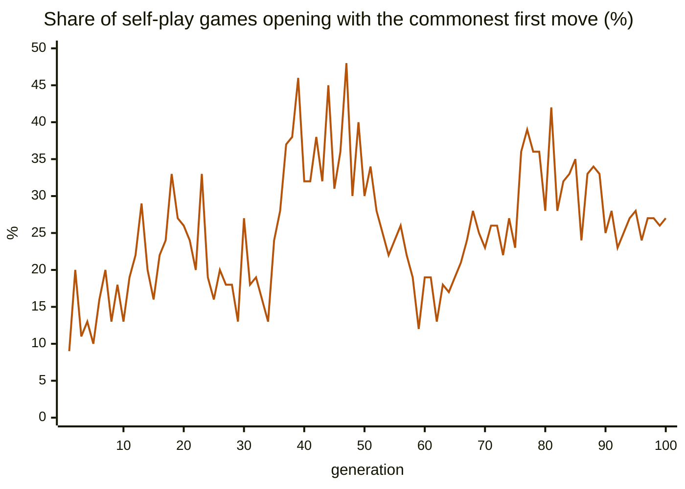

# The training runs: what was tried, and what it taught us

[← Back to the README](../README.md) · [Training](TRAINING.md) · [Benchmarking](BENCHMARKING.md)

Four runs took the agent from a pipeline that worked but learned nothing useful to a network that
wins every game against the Greedy baseline. Each run's results are in [`results/`](../results),
and the whole runs (networks and games) on the release
[`training-runs`](https://github.com/Aditya-00786/csf407-fable-chaturanga-zero/releases/tag/training-runs).

| Run | Network | Simulations | Games a generation | Generations | Self-play games | Time | Where |
|---|:-:|:-:|:-:|:-:|:-:|:-:|---|
| `main` | 6 × 64 | 50 | 50 | 20 | 1,000 | about 2 hours | Apple M1 |
| `main-v2` | 6 × 64 | 50 | 50 | 20 | 1,000 | 34 minutes | lab server, 9 CPU processes |
| `main-v3` | 6 × 64 | 50 | 500 | 40 | 20,000 | about 4 hours | lab server, 20 CPU processes |
| `main-v4` | 10 × 128 | 200 (400 in 76–90) | 500 | 100 | 50,000 | about 57 hours | lab server, the network on the GPU |

Self-play games count every game, endgame starts included: `main-v4`'s 50,000 are 35,019 played from the
opening and 14,981 from endgames.

## main: the pipeline works, the value head does not

20 generations, 1,000 self-play games from the opening, about 2 hours on an M1.

| | Untrained | Generation 20 |
|---|:-:|:-:|
| Policy loss on unseen games | 8.32 | 2.50 (lowest possible: 1.93) |
| Value loss on unseen games, vs predicting a draw | 0.49 vs 0.47 | 0.40 vs 0.33 |
| vs Random, 20 games at 50 simulations | 11 W / 9 D / 0 L | 1 W / 19 D / 0 L |
| vs Greedy, 20 games | 0 / 0 / 20 | 0 / 1 / 19 |

The policy head learned to predict the search's moves. The value head did not learn at all: it
rated a side missing both Rathas the same as the starting position, so the sharper policy only
narrowed a search with nothing to aim for. **The cause was the data:** from the opening, games run
about 250 plies and only about 40% are decided, so about 400 noisy results had to teach the value
of every position.

**What changed:** endgame starts (30% of games from random positions with a few pieces a side:
short, decided games that show what pieces are worth), and better tests (16 sampled opening plies,
Random as an opponent, the best network chosen on 40 games).

## main-v2: the lab server, and a value head that memorises

The same 20 generations of 50 games, with endgame starts, in 34 minutes on the server. It failed
the same way, and showed why:

| Value loss of generation 19 (vs predicting a draw) | Games it trained on | New games |
|---|:-:|:-:|
| From the opening | 0.11 (0.31) | 0.43 (0.36) |
| Endgame starts | 0.21 (0.68) | 0.65 (0.63) |

On games in its buffer the value head was three times better than predicting a draw; on new games
it was worse. **It had learned its 300 or so games by heart:** every position of a game shares one
result, and a network can tell which game a position came from.

**What changed:** far more games (500 a generation, a buffer of 300,000 positions) and a **blended
value target**, the average of the game's result and the search's own estimate at each position:
less noisy, and harder to memorise.

## main-v3: the value head learns, but not tactics

20 generations of 500 games, then 20 more at temperature 0.5 after the opening.

| | `main-v2`, final | `main-v3`, generation 20 |
|---|:-:|:-:|
| Value loss on new games, vs predicting a draw | 0.42 vs 0.34 | 0.59 vs 0.87 |
| vs Random, strength check | 3 W / 17 D / 0 L | 17 W / 3 D / 0 L |
| vs Greedy | 0 W / 1 D / 19 L | 0 W / 0 D / 20 L |
| Self-play games from the opening decided | 39% | 88% |

The network learned what pieces are worth, from self-play alone: taking a piece off the board moves
its value by 0.37 for a Ratha, 0.15 for an Ashva, 0.10 for a Gaja, 0.07 for a Mantri and 0.05 for a
Padati, close in proportion to Greedy's hand-set 5, 3, 1.5, 1.5 and 1. **What it lacked was
tactics:** against Greedy it lost material on about a dozen moves a game, and won 2 of 400 test
games in generations 31 to 40.

<b>The experiments that looked for the cause (generations 39 and 40)</b>

| Experiment | Result |
|---|---|
| More search: 50, 200 and 800 simulations against Greedy | about 11 to 13 material-losing moves a game at every size |
| Temperature after the opening, 1 / 0.5 / 0.25 / 0 | free material taken 30 / 40 / 44 / 45% (0.5 adopted) |
| A lower learning rate on the same games | no lower loss on new games |
| A bigger network (10 × 128), from scratch on the same games | value slightly better (0.682 against 0.693) |
| The result alone as the value target | memorises again: worse than predicting a draw |
| How the search treats untried moves | no change against Greedy |
| An even share of attention at the root | still 0 to 1 wins in 40 against Greedy |
| Flattened priors everywhere, 800 simulations | still about 13 material-losing moves a game |

Where a free Ashva or Ratha was left, the network rated the position after the capture higher in 28
of 40 cases, but its policy gave the capture a prior of 0.003 to 0.03, so the search seldom tried
it, and it gave the opponent's captures the same neglect. A policy that does not look at captures
plays games where loose pieces go unpunished, which teaches it nothing about them: a loop that
settings did not break. AlphaZero learned tactics with 800 simulations, a 20 × 256 network and
millions of games; `main-v3` had 50 simulations, a 6 × 64 network and 20,000 games.

## main-v4: a bigger network and a deeper search

A 10 × 128 network (3.5 million parameters), 200 simulations a move and 500 games a generation, with
self-play's network on the server's GPU. **It learned tactics.** The deeper search gave the policy
targets that take loose pieces: by generation 20 it took a free Ashva 76% of the time and a free
Ratha 82%.

| Generations | vs Greedy | vs Random | vs the generation before | Self-play draws (at the ply cap) |
|---|:-:|:-:|:-:|:-:|
| 1 to 10 | 2% | 92% | 68% | 18% (12%) |
| 11 to 20 | 20% | 96% | 58% | 12% (5%) |
| 21 to 30 | 53% | 98% | 55% | 20% (13%) |
| 31 to 40 | 69% | 98% | 53% | 26% (17%) |
| 41 to 50 | 82% | 98% | 53% | 25% (16%) |
| 51 to 60 | 89% | 99% | 51% | 29% (19%) |
| 61 to 70 | 92% | 100% | 53% | 28% (19%) |
| 71 to 80 | 95% | 100% | 52% | 34% (22%) |
| 81 to 90 | 97% | 100% | 52% | 42% (26%) |
| 91 to 100 | 98% | 100% | 50% | 31% (19%) |

| Strength check, 20 games each at 200 simulations | vs Random | vs Greedy |
|---|:-:|:-:|
| Untrained | 8 W / 12 D / 0 L | 0 W / 3 D / 17 L |
| Generation 20 | 18 W / 2 D / 0 L | 7 W / 7 D / 6 L |
| Generation 40 | 20 W / 0 D / 0 L | 16 W / 3 D / 1 L |
| Generation 60 | 20 W / 0 D / 0 L | 18 W / 2 D / 0 L |
| Generation 72 | 20 W / 0 D / 0 L | 19 W / 1 D / 0 L |
| Generation 75 | 20 W / 0 D / 0 L | 18 W / 1 D / 1 L |
| Generation 90 | 20 W / 0 D / 0 L | 20 W / 0 D / 0 L |
| Generation 100 | 20 W / 0 D / 0 L | 20 W / 0 D / 0 L |

<b>The run's six charts: losses, test scores and self-play over 100 generations</b>

From generation 61 on, tests and strength checks use the search's rules (a win in one taken,
one for the opponent avoided); the untrained network's row was measured with them too.

### Four stretches, four settings

Progress levelled off at generation 56. Each change after that was tried for 10 to 15 generations
and judged on the [rating ladder](BENCHMARKING.md#the-rating-ladder):

| Generations | What changed | Time | Elo gained | Elo an hour |
|---|---|:-:|:-:|:-:|
| 1 to 60 | (the start: learning rate 1e-3, 200 simulations) | about 42 h | +812 | about 19 |
| 61 to 70 | learning rate down to 3e-4 | 3.1 h | +89 | about 29 |
| 71 to 75 | (the same) | 1.5 h | +20 | about 13 |
| 76 to 90 | self-play searching 400 simulations | 7.7 h | +68 | about 9 |
| 91 to 100 | learning rate down to 1e-4, 200 simulations again | 3.0 h | +51 | about 17 |

- **The first step down of the learning rate paid best**, restarting progress after nothing between
  generations 56 and 60, as AlphaZero's own steps did late in training.
- **The deeper search paid least per hour:** about the same gain per generation, at 31 minutes a
  generation instead of 18. It also made self-play more drawn (60% of games from the opening decided,
  against 71%).
- **The network is near what it can fit.** At generation 100 the policy's loss on its own training
  batches is 2.10, hardly below the 2.18 on new games, while the lowest possible is 1.75: it is not
  memorising, it cannot match the search's choices much more closely.

<b>The stretches in detail</b>

| Generations | vs the generation before | vs Greedy | Self-play decided | at the ply cap | by repetition | Length | Policy loss on new games | Value loss / predicting a draw |
|---|:-:|:-:|:-:|:-:|:-:|:-:|:-:|:-:|
| 51 to 60 (1e-3) | 51.2% | 88.6% | 71% | 19% | 10% | 209 | 2.30 | 0.79 |
| 61 to 75 (3e-4) | 52.5% | 92.3% | 71% | 19% | 10% | 198 | 2.26 | 0.80 |
| 76 to 90 (400 simulations) | 52.8% | 96.3% | 60% | 25% | 14% | 211 | (sharper targets) | 0.81 |
| 91 to 100 (1e-4) | 49.8% | 97.9% | 69% | 19% | 12% | 199 | 2.18 | 0.77 |

- From generation 61, self-play takes every win in one, so its games got shorter (209 plies to 198).
- Generations 70, 72 and 75 each beat generation 60 17 times in 40 and lost 1 to 4; generation 100
  beat 75 and 72 20 times each with no losses, and 90 11 times with one loss.
- Between strong generations most games are drawn, mostly by repetition: 22 to 32 of 40 between
  generations 70 and 100.

## What the trained agent plays

Measured on the lab server with `main-v4`'s networks; the scripts are kept with their logs in the
server's `analysis/` folder.

### Its sense of material

The value each network gives a position, White to move, from −1 (sure to lose) to +1 (sure to win):

| Position | Untrained | Generation 60 | Generation 100 |
|---|:-:|:-:|:-:|
| The starting position | −0.04 | +0.02 | +0.02 |
| Black without its Rathas | −0.04 | +0.37 | **+0.97** |
| White without its Rathas | −0.04 | −0.80 | **−0.92** |
| Black without Ashvas and Rathas | −0.04 | +0.98 | +1.00 |
| White without Ashvas and Rathas | −0.04 | −0.98 | −1.00 |
| Black down to its Raja and 4 Padatis | −0.04 | +0.99 | +1.00 |

By generation 100, two missing Rathas decide the game for it either way; at generation 60 that was
still a matter of degree.

### Openings

No opening was given to it, and it formed and changed its own preferences, as AlphaZero's chess
openings shifted during its training:

| Generation | Its favourite first moves (its policy at the start) | Self-play's commonest first move |
|---|---|:-:|
| 1 | Ashva b1-a3 8%, Ashva b1-c3 8% (no preference) | 9% of games |
| 20 | g3 22%, Gaja c1-e3 12% | 26% |
| 40 | f3 37%, e3 11% | 32% |
| 50 | h3 40%, f3 13% | 30% |
| 60 | g3 16%, h3 13%, a3 13%, Ashva g1-f3 12% | 19% |
| 70 | Gaja c1-a3 21%, d3 16%, g3 13% | 23% |
| 80 | d3 33%, a3 12%, Ashva b1-a3 11% | 28% |
| 90 | a3 32%, b3 24%, g3 14% | 25% |
| 100 | b3 26%, g3 23%, a3 19% | 27% |

- **Its preferences sharpen and spread again.** They peaked at generation 47 (48% of games opened
  with its favourite), spread out by 60, sharpened again while self-play searched 400 simulations
  (generations 76 to 90), and spread again after.
- **Quiet set-ups, built before contact.** Its favourites are edge Padati moves and Gaja and Ashva
  development; in generations 91 to 100 the commonest openings were mirrored walls such as
  1. a3 a6 2. b3 b6 and 1. b3 b6 2. a3 a6. Modern chess openings do not apply (no queen, no
  long-range bishops, no castling, no double step); the nearest historical idea is the shatranj
  *tabiya*, a set-up both sides built before contact.
- **Still no long plan in quiet positions.** Against itself at Hard, generation 100 plays
  1. b3 b6 2. a3 a6 3. h3 h6 4. e3 g6 5. b4 Gd6 6. f3 c6 7. h4 Nf6 8. Ne2 Kc7 9. Rh2 Kd8 10. d3 Kc7:
  Padati walls, and a Raja stepping out and back, as generation 60 did.

### Chaturanga's fool's mate

Scholar's and fool's mate need a queen and bishops, but a Raja walled in by its own pieces can be
smothered by an Ashva in four moves: 1. Nc3, 2. Na4, 3. Nc5 and 4. Nxb7 mate (for Black,
...Nf6-h5-f4xg2). A scripted attacker that plays straight for it mated **none** of the networks
tried, from the untrained one to generation 100, as either colour, and the trained ones punish it:
generation 100 as White takes the raiding Ashva the moment it lands on f4 (gxf4); as Black it takes
it on c5 (...bxc5).

### Raja safety

In positions from its games where some moves lose at once (mate, or its last piece taken) and
others do not, how often the search alone (200 simulations, without the search's rules) picks a safe
move:

| Network | Positions (from its own games) | Picked a safe move |
|---|:-:|:-:|
| Generation 36 | 72 | 81% |
| Generation 60 | 46 | 87% |
| Generation 100 | 27 | 67% |

Like for like, on the same 46 positions from generation 60's games, **generation 100 picks a safe
move 61% of the time (28), against 87% (40) for generation 60**: its own search got worse at
spotting a move that loses at once. Why is not known yet. It does not show in its games, since the
search's rules catch every such move, but it is a regression to watch in later training.

In Play, the tests and the ladder, the search's rules pick a safe move whenever there is one.

### Finishing a won game

A win counts the same however long it takes, so the network has no reason of its own to prefer
the quick finish; AlphaZero is known for the same. In positions from its self-play where a move wins
at once, how often the search alone (without the search's rules) took it:

| | Around generation 40 | Generation 60 | Generation 100 |
|---|:-:|:-:|:-:|
| Self-play's own search: its favourite move | 51% | 53% | 66% |
| Searched again at Hard (200 simulations) | 55% | 48% | 65% |
| Searched again at Impossible (800 simulations) | 65% | 50% | 77% |

On the same 60 positions from generation 60's games, generation 100 took the win 58% of the time at
Hard and 60% at Impossible, against generation 60's 48% and 50%.

- **Generation 60 missed wins for a near tie:** the winning move got about as many visits as
  another that wins a little later, whose value of 0.997 is too close to the win's 1.0 to matter.
- **Generation 100 takes more of them, and misses for the old reason:** in positions from its own
  games, where it does not, the winning move's prior is 0.007 to 0.03 and the search never tries it.
- **Since generation 61, the search's rule takes every one** in self-play, the tests and Play, so
  generation 100's own games end at the first win in one (395 positions in its self-play, against
  781 at generation 60).
