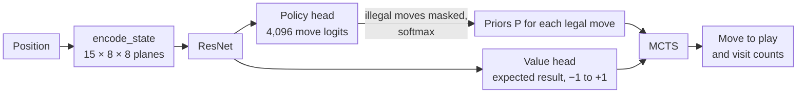
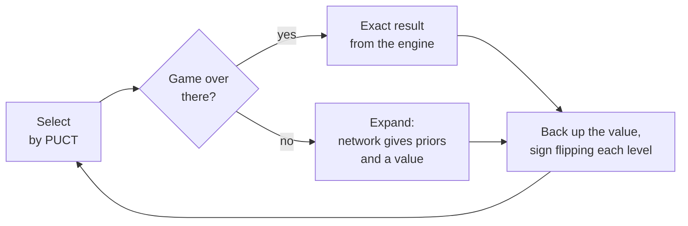
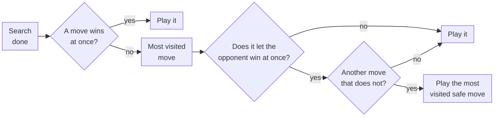

# How the agent thinks: network and search

[← Back to the README](../README.md)

The agent has two learned-search parts, as AlphaZero does: a **network** that looks at a position
and suggests moves and an evaluation, and a **Monte Carlo Tree Search** that uses those
suggestions to look ahead. Finished games are scored exactly by the rules engine, never by the
network.



## The network

`chaturanga/net.py` is a residual convolutional network over the 15 input planes. The policy head
gives 4,096 logits (one per from-square and to-square); the evaluator masks the illegal ones and
applies a softmax. The value head gives the expected result for the side to move, from −1 to +1.
The size is set in `NetConfig` (the trained agent is 10 blocks × 128 filters, 3.5 million
parameters), and `new_network(seed=…)` always builds the same weights for the same seed.

## The search

Each simulation walks down the tree, expands the first new position with the network, and backs
its value up the path, flipping the sign at every level because the players alternate:



At each node it picks the move with the highest

$$Q(s,a) + c_{\text{puct}} \cdot P(s,a) \cdot \frac{\sqrt{N(s)}}{1 + N(s,a)}$$

where $Q$ is the move's mean value so far, $P$ its prior from the network, $N$ the visit counts and
$c_{\text{puct}} = 1.5$. After the simulations it plays the most visited move (or samples in
proportion to visits, in self-play's opening).

```python
from chaturanga import GameState, move_to_str
from chaturanga.mcts import MCTS, MCTSConfig
from chaturanga.net import NetworkEvaluator, new_network

evaluator = NetworkEvaluator(new_network(seed=0))         # untrained 6×64 ResNet, CPU or CUDA
mcts = MCTS(evaluator, MCTSConfig(simulations=50), seed=0)

state = GameState.from_fen("7k/7p/4K2P/8/8/8/8/R7 w")
root = mcts.search(state)                                # 50 simulations from this position
print(move_to_str(mcts.choose_move(root)))               # a1a8: mate, avoiding the stalemate trap
print(MCTS.visit_counts(root), MCTS.root_value(root))    # visits per move, value for White
pi = MCTS.policy_target(root)                            # 4,096-long training target
```

| Control | What it is for |
|---|---|
| Dirichlet noise at the root (`add_noise=True`) | self-play explores moves the network undervalues |
| Temperature (`choose_move(root, temperature)`) | 0 plays the most visited move; above 0 samples in proportion to visits |
| Tree reuse | searching the position after the opponent's reply keeps the work already done on it |
| `make_agent("mcts")` | the untrained agent of Milestone 2: 50 simulations, no noise, the app's "MCTS" opponent |

## The search's rules

Leela Chess Zero lays proven results over its search: a move that ends the game is known exactly,
whatever the visits say. ChaturangZero applies two rules when it chooses a move, and one more for
draws:



1. **Take a win in one.** If a move wins at once (checkmate, a bare Raja, or a stalemate, which the
   stalemated side wins), play it.
2. **Don't allow one.** If the chosen move lets the opponent win at once, or loses by itself (it
   stalemates the opponent), play the most visited move that does neither, if there is one.
3. **Contempt.** A finished game that is drawn is worth −c to the player searching instead of 0,
   and +c to its opponent, so it avoids draws it can avoid at no greater cost.

All three need no retraining. The first two cost about half a millisecond a move; the visit
counts, and so self-play's training targets, stay as the search left them.

| Where | Take a win | Don't allow one | Contempt |
|---|:-:|:-:|:-:|
| Play: Hard and Impossible | Yes | Yes | 0.3 |
| Play: Easy and Medium (they stray from their best move on purpose) | No | No | No |
| Play: MCTS (Milestone 2's baseline) | No | No | No |
| Test games, strength check, rating ladder | Yes | Yes | No |
| Self-play | Yes | No | No |

<details>
<summary><b>Why: generation 60 took a win in one only half the time</b></summary>

In generation 60's self-play there were 781 positions where a move would win at once; the move
played took it 46% of the time, and Play's Hard and Impossible 48% and 50%. The search is not blind
to the win: another move that wins a little later gets about as many visits (48 against 50, say),
and its value of 0.997 is too close to the win's 1.0 to matter, so the visits follow the priors.
See [the runs](RUNS.md#finishing-a-won-game) for how this changed by generation 100.

</details>

<details>
<summary><b>Measured: the first two rules, generation 60, the same seeds three ways</b></summary>

100 test games against each opponent and 160 self-play games (106 from the opening), on the lab
server:

| Test games | No rules | Take wins | Both rules |
|---|:-:|:-:|:-:|
| vs Random (W / D / L) | 99 / 1 / 0 | 99 / 1 / 0 | 99 / 1 / 0 |
| Plies to win against Random (median, mean) | 103, 116 | 87, 94 | 87, 94 |
| vs Greedy (W / D / L) | 82 / 11 / 7 | 82 / 11 / 7 | 83 / 12 / 5 |
| Plies to win against Greedy (median, mean) | 190.5, 189 | 182.5, 179 | 182, 178 |
| Time for the 300 games | 6.8 min | 6.7 min | 6.8 min |

| Self-play | No rules | Take wins | Both rules |
|---|:-:|:-:|:-:|
| Games from the opening decided | 69 of 106 | 75 of 106 | 63 of 106 |
| Their median length | 219 plies | 199 | 236 |
| Their mates | 15 | 28 | 8 |

- **Won games end sooner**: against Random 16 plies sooner at the median, and four times as often
  by mate; the scores hardly move, as those games were won already.
- **No cost in time.**
- **Self-play takes wins only.** Not allowing them there makes both sides parry every mate in one:
  fewer decided games (63 against 75), mates down from 28 to 8, and the network would stop seeing
  its search's blunders punished, which is how it learns to avoid them.

</details>

<details>
<summary><b>Measured: contempt, generation 90 against generations 90, 80, 75 and Greedy</b></summary>

By generation 90, most games between strong generations were drawn by repetition. Generation 90
with contempt played opponents without it, 40 games each from the opening, the same seeds for
every c:

| Contempt | vs gen 90 | vs gen 80 | vs gen 75 | vs Greedy | Draws by repetition / at the ply cap |
|---|:-:|:-:|:-:|:-:|:-:|
| 0 | 9 / 23 / 8 | 10 / 26 / 4 | 8 / 31 / 1 | 38 / 2 / 0 | 64 / 16 |
| 0.1 | 7 / 27 / 6 | 9 / 27 / 4 | 10 / 29 / 1 | 40 / 0 / 0 | 38 / 45 |
| 0.3 | 8 / 28 / 4 | 11 / 27 / 2 | 12 / 26 / 2 | 40 / 0 / 0 | 6 / 74 |

Repetitions all but went, but about as many games were drawn at the 300-ply cap instead: when
neither side finds a way through, avoiding repetition does not find one either. It won a little
more (59.6% against 55.8%, about +27 Elo, within chance), and its two draws against Greedy became
wins. So Play's strongest levels use it; the tests, the ladder and self-play do not, to keep their
scores comparable and the value targets unbiased.

</details>

## Before training: the Milestone 2 baseline

`scripts/mcts_benchmark.py --sims 50 --games 10 --threads 1`, on an Apple M1:

| Untrained MCTS, 50 simulations per move | Wins | Draws | Losses | Notes |
|---|:-:|:-:|:-:|---|
| vs Random | 5 | 5 | 0 | every win is a bare king; the draws reach the 300-ply cap |
| vs Greedy | 0 | 0 | 10 | Greedy knows piece values; the untrained network does not |

## Tests

`tests/test_mcts.py` and `tests/test_net.py` check that:

- the search finds mate, bare-king wins and the stalemate trap for both colours, with uniform
  priors and with the untrained network;
- values have the right sign, visits add up, and only legal moves are searched;
- root noise, temperature, tree reuse, policy targets, network shapes, seeding and checkpoints
  behave as intended;
- the rules take a win the search passed over, turn down a move that loses at once, keep the
  search's choice when every move loses, and leave the visits alone;
- contempt makes a draw cost the player searching and help its opponent.

Nine bugs planted in the search, one at a time, each made the tests fail.
