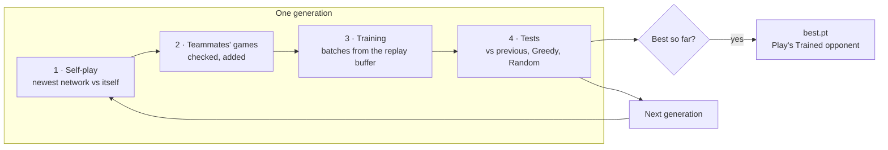
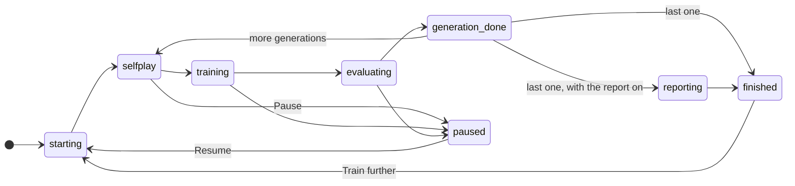
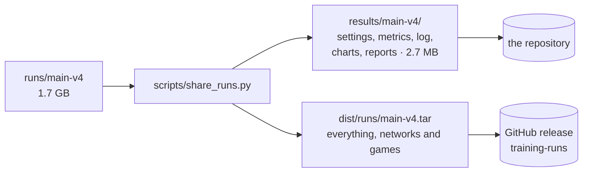

# Training by self-play

[← Back to the README](../README.md) · [Training on servers and in the cloud](TRAINING_REMOTE.md) · [The runs so far](RUNS.md)

The network plays itself with MCTS, learns from those games, and the improved network plays the
next batch: AlphaZero's loop, with every generation tested, saved and logged.



## Starting a run

From the app: **New run** on the Training page asks for a name, where to train (this Mac, Colab,
Kaggle or your own server), the generations and games per generation, and under More settings the
simulations and test games. It shows a rough time and starts the training in the background. One
run trains at a time on each machine. From a terminal:

```bash
python scripts/train.py                  # run "main": 20 generations of 50 games
python scripts/plot_training.py          # its curves, runs/main/training.png
```

## One generation

| Step | What happens |
|---|---|
| **1 · Self-play** | The newest network plays itself, one process per core (or on the GPU, 32 games per process). Each move searches with root noise; moves are sampled in proportion to visits for the first 30 plies, then at temperature 0.5. A move that wins at once is always taken. 30% of games are **endgame starts**: a random legal position with each Raja and 1 to 5 of its pieces. |
| **2 · Teammates' games** | Game files in `runs/<run>/incoming/` are replayed move by move and added if every move and visit count is legal; anything else goes to `games/rejected/`. |
| **3 · Training** | Batches of 256 positions from the replay buffer (the newest 60,000 positions, or about three generations when those are larger: 300,000 for 500 games). The loss is AlphaZero's: the value's squared error plus the policy's cross-entropy against the visit shares, with weight decay (AdamW). Steps are set so each new position is sampled about four times, at most 2,000. |
| **4 · Tests** | The new network plays the previous generation, Greedy and Random without noise, sampling its first 16 plies so games differ, all side by side and batched. |

**Training targets.** Every position becomes an example: the board, the search's visit shares (the
policy target) and a value target, the game's result averaged with the search's own estimate at
that position (`value_mix` 0.5). The blend keeps the value head from learning games by heart.
[The runs](RUNS.md) tell how each of these came about.

<details>
<summary><b>Batched test games: the same games, five times faster</b></summary>

A generation's test games are played side by side: positions waiting for the same network, from
every game, go to it in one batch, and each game is played exactly as it would be alone. Replaying
`main-v4`'s generation 40 tests (120 games) on the idle lab server, every way gave the same 120
games, move for move:

| How the test games were played | Minutes |
|---|:-:|
| One game, one position at a time | about 29 |
| One opponent at a time, 4 games per worker, 10 workers | 17.6 |
| Every opponent together, 12 per worker, 10 workers | 8.3 |
| Every opponent together, 24 per worker, 5 workers (now) | 5.8 |

</details>

## The best network, and Play

The **best** network scores highest against Greedy and Random together (40 games, so a few lucky
draws do not decide it; later generations win ties). It is copied to `checkpoints/best.pt`, where
the app's Trained opponent picks it up without a restart.

Each run's **In Play** menu chooses which of its networks Play uses: the best or the latest
(followed as the run trains), or any other generation (kept until another is chosen; the menu lists
them by their test score against Greedy). One run feeds Play at a time.

## What a run keeps

Everything lives in `runs/<run>/` (git-ignored; see [Sharing runs](#sharing-runs)):

| Path | Contents |
|---|---|
| `config.json` | the run's settings |
| `metrics.jsonl` | one line per event: training losses every 10 steps, self-play results, the loss on each generation's new games before training on them, tests |
| `status.json` | what the run is doing now; the Training page reads it |
| `games/gen_NNNN.jsonl.gz` | every self-play game: moves, visit counts, the search's value at each move, the result (about 40 KB a game) |
| `checkpoints/gen_NNNN.pt` | the network after each generation, plus `best.pt` and `train_state.pt` (the optimiser) |
| `report/` | the run report, strength check and rating ladder |
| `incoming/` | teammates' game files waiting to be added |
| `launch.json` | for a run started from the app: where it trains, and which network Play uses |

## Pausing and resuming



| Pause | What happens |
|---|---|
| **Now** (Ctrl+C too) | Stops within seconds. Every finished self-play game is kept (each is saved as it ends); games in progress, and a half-done training or test, are redone on resuming. |
| **After this phase** | Finishes the current self-play, training or tests, then stops. |
| **After this generation** | Finishes the whole generation, tests included. |

**Resume** (or `python scripts/train.py --run <name>`) picks up exactly where it stopped, playing
only the self-play games still missing: the same games it would have played without the pause. A
run that ended without pausing (the machine restarted) resumes the same way. **Train further**
takes a finished run past its planned generations; nothing caps it.

## Changing settings as it goes

**Settings**, beside Resume and Train further, changes what the coming generations do. Each start
records its settings in `metrics.jsonl` (`"event": "start"`), so a change is on record from the
generation it applies to.

| Setting | What it changes |
|---|---|
| Games per generation | more data each generation; the buffer grows to match |
| Self-play simulations per move | a deeper search: sharper targets, slower in proportion |
| Test simulations per move (`--eval-sims`) | the search of the test games and strength check; unset, they follow self-play's. Keep it to compare scores with earlier generations |
| Test games per opponent | steadier test scores, at more time |
| Learning rate | lowered in steps late in a run, as AlphaZero did |
| Temperature after the opening | lower plays the favourite move more; higher explores more |
| The report at the end | the run report, strength check and new ladder ratings when the run finishes |
| Self-play processes, and how many on the GPU | a run on your own server only |

The network's size stays. The rating ladder keeps the search it began with, whatever the run's
becomes.

## Why self-play works the way it does

<details>
<summary><b>Why moves are sampled at temperature 0.5 after the opening</b></summary>

AlphaZero sampled only its opening moves and then played the most visited move. Our first attempt
did the same, and by generation 3 both sides shuffled pieces until a position repeated: 34 of 50
self-play games ended in threefold repetition, and almost nothing decisive was left to learn from.
Measured with the generation 3 network over 28 games each:

| Moves after ply 30 | Decisive games | Repetition draws |
|---|:-:|:-:|
| Most visited (temperature 0) | 3 | 22 |
| Temperature 0.5 | 6 | 10 |
| In proportion to visits (temperature 1) | 10 | 2 |

Sampling at temperature 1 had a cost, found in the third run: an opponent that samples its moves
often leaves a free piece where it stands, so the value head learned that a loose piece is usually
safe. Measured with that run's generation 20 over 36 games each:

| Moves after ply 30 | Decisive games | Repetition draws | Free material taken |
|---|:-:|:-:|:-:|
| Most visited (temperature 0) | 72% | 25% | 45% |
| Temperature 0.25 | 75% | 22% | 44% |
| Temperature 0.5 | 89% | 8% | 40% |
| In proportion to visits (temperature 1) | 81% | 17% | 30% |

So self-play plays at temperature 0.5 after the opening: blunders are punished a third more often,
without the repetition draws of a lower temperature. The policy target is the visit distribution
either way.

</details>

<details>
<summary><b>Measuring honestly: losses on games the network has not seen</b></summary>

A network can lower its training loss by memorising games. So before each generation trains on its
new self-play games, the loss on those unseen games (from the opening) is logged too, and the value
loss there is compared with the score of predicting a draw everywhere. The Training page and
`plot_training.py` show both. This is what caught the second run's value head learning its games
by heart (see [the runs](RUNS.md#main-v2-the-lab-server-and-a-value-head-that-memorises)).

</details>

## Playing the trained agent

In the app choose **Trained** as the opponent (or for either side in Computers mode) and a level:

| Level | Simulations per move | Move choice |
|---|:-:|---|
| Easy | 10 | sampled in proportion to visits: it often strays from its favourite |
| Medium | 50 | visits sharpened (temperature 0.5): usually its favourite |
| Hard | 200 | always the most visited move, with the search's rules and contempt 0.3 |
| Impossible | 800 | as Hard; about a second a move |

From Python: `make_agent("zero", level="hard")`. The server reads the network from
`checkpoints/best.pt`, or from the file named by `CHATURANGA_CHECKPOINT`; the Training page reads
runs from `runs/`, or from `CHATURANGA_RUNS`.

## The run report

A report sums up what a run learned: **Make report** in the Training page's Run report section, or
`python scripts/report.py --run <name>`. A run started with **Make the run report when it
finishes** makes it, strength check included, as soon as its last generation is done, and a run
already on the rating ladder rates its new generations there too. The status card shows each part
and its games as they finish.

| Part | What it shows |
|---|---|
| **Findings** | whether the policy learned to predict the search, whether the value beat predicting a draw on unseen games, how test scores and self-play moved |
| **Does the value head see material?** | the value the untrained, best and final networks give positions with pieces missing on one side or the other |
| **Strength check** | the untrained, best and final networks against Random and Greedy, 20 games each |
| **Rating ladder and conversion test** | Elo for the run's generations, and how surely and quickly each turns a small edge into a win (see [Benchmarking](BENCHMARKING.md)) |
| **Self-play over the run** | how games from the opening ended, generation by generation, and their length |

<details>
<summary><b>How the strength check stays fast and exact</b></summary>

- **Kept results.** A network the last check measured with the same settings (the same file, by its
  contents) keeps its results instead of playing again: its games would come out the same. After
  training further, that is the untrained network, whose games are the longest.
- **One network to a task on a GPU, at most 20 games a task.** `main-v4`'s check (3 networks, 120
  games) took 2.9 minutes this way against 7.4 with the networks mixed, the same 120 games move for
  move. Tasks of 40 were faster still (2.2 minutes) but changed 19 games, because the GPU's
  arithmetic shifts slightly with the batch size.
- **Where it plays.** Where the run trained: a server run's on its server (followed from the page,
  playing on if the connection drops), a Mac run's on the Mac. Training waits while one plays.

</details>

## Team self-play

Self-play is the slow part, and it parallelises across people as well as cores. Whoever runs the
training shares a checkpoint (`runs/<run>/checkpoints/gen_NNNN.pt`); each teammate runs

```bash
python scripts/selfplay.py --checkpoint gen_0005.pt --games 50 --name aadit
```

and sends back the `.jsonl.gz` file it writes, which goes into `runs/<run>/incoming/`. Game files
are merged, not trained networks: averaging separately trained weights does not give a better
network, but more games from the current network always help.

## Sharing runs

`runs/` is git-ignored: `main-v4` alone is 1.7 GB, and GitHub takes no file over 100 MB.
`python scripts/share_runs.py <run> ...` shares a run in two parts:



To bring a run back into the app:

```bash
gh release download training-runs -p main-v4.tar
```

```bash
tar -xf main-v4.tar -C runs/
```

> [!NOTE]
> Neither part holds what ties a run to the machines it used: its launch settings with the server's
> address and folder, the followers' logs, and the machines' names in its status and reports. A run
> brought back shows as finished on the machine it is unpacked on. After training a run further,
> run the script again, commit `results/` and upload the new archive with
> `gh release upload training-runs dist/runs/<run>.tar --clobber`.

## Tests

`tests/test_training.py` and `tests/test_training_api.py`: self-play records are legal, finished
games that replay exactly; the same seed gives the same games, batched or one at a time; policy
targets equal the search's visit distribution; tampered records are rejected; the buffer keeps the
newest games; a small network overfits a fixed buffer (the loss and gradients work); a run trains,
publishes, takes a teammate's games, rejects a tampered one, pauses and resumes; the trained agent
plays at every level; and the Training API lists runs, losses, generations and games.
`tests/test_share_runs.py` checks that shared runs leave their machines' details behind.
