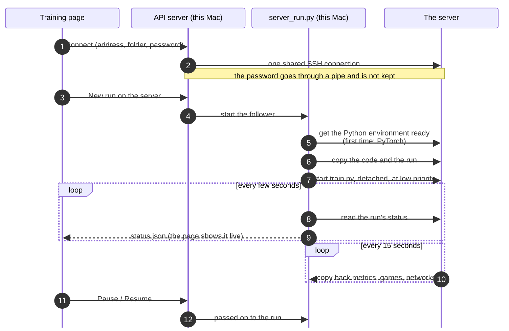
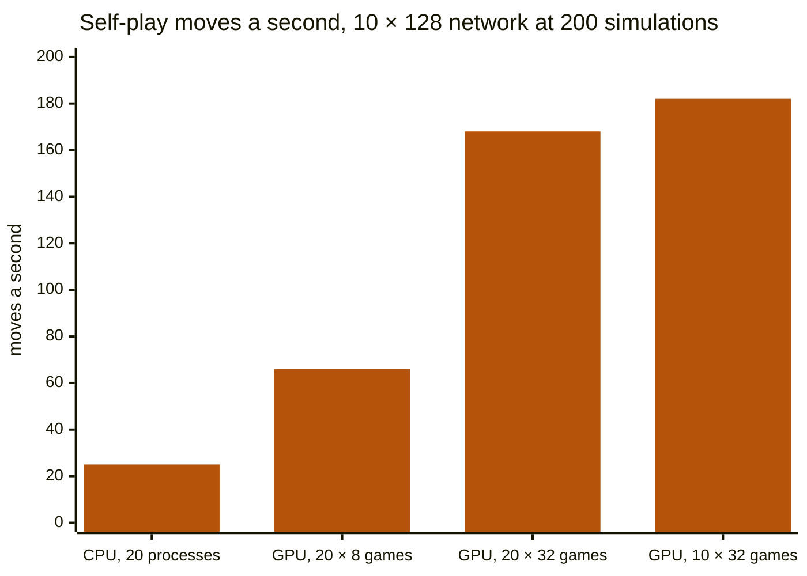

# Training on servers and in the cloud

[← Back to the README](../README.md) · [Training](TRAINING.md)

**New run** asks **Where**: this Mac, Colab, Kaggle or your own server. Wherever it trains, the
Training page follows the run as if it were local.

| Where | Best for | Live progress | Pause and Resume | Limits |
|---|---|:-:|:-:|---|
| **This Mac** | small runs, trying things | Yes | Yes | its own cores; keeps the Mac busy |
| **Colab** | a free GPU without setup | Yes (through Google Drive) | Yes | one click per session to start; free machines have 2 cores |
| **Kaggle** | a free GPU, hands-off | when it comes home | stop on Kaggle | sessions end at 12 hours (it pauses itself at 11) |
| **Your own server** | real runs | Yes | Yes | any Linux machine you can reach with `ssh` |

All of `main-v2`, `main-v3` and `main-v4` trained on the lab server.

## Your own server

Any Linux machine you can reach with `ssh`, with Python 3.10 or newer and `rsync`. In New run
choose **Server**, give its address (or pick a host from `~/.ssh/config`), a folder for everything,
and its password, and press **Connect**.



- **The password** opens one shared SSH connection (OpenSSH's ControlMaster, its socket in
  `~/.chaturanga/ssh/`, readable by you only). It reaches ssh through a pipe, never a file. A server
  that accepts your SSH key needs no password.
- **The training carries on** if the Mac sleeps or the connection drops. The page asks for the
  password again, and connecting picks the run up where it is, also after the Mac restarts. A right
  password closes the prompt with a green "Connected", and while the app copies back what the run
  made meanwhile, the run shows as "catching up".
- **The strength check and the rating ladder** of a server run play on the server too, followed the
  same way.
- **Deleting a run** deletes the server's copy too.

On the server everything stays in the one folder:

```
<folder>/env/        the Python environment (pip's caches in cache/, temporary files in tmp/)
<folder>/code/       the training code, copied before each start
<folder>/runs/<run>  the runs, as in runs/ here
```

### CPU and GPU together

Each self-play process runs its search on its own CPU core; its network runs there too, or, for the
processes set **on the GPU** (`--gpu-workers`), on the server's GPU, which then plays 32 games side
by side in each process so its batches are large. On the lab server (Core Ultra 9 285K, RTX 5000
Ada), in self-play moves a second:



The GPU is the limit: fewer processes with larger batches beat more with small ones. For a large
network, put about 10 processes on the GPU and none on the CPU; the free cores serve the training
and anyone else on the machine. (The small 6 × 64 network plays about 500 moves a second on 20 CPU
processes alone.)

## Colab

Google offers no way for another program to start a Colab notebook, so the app does the rest
around the one click that needs you:

1. The app writes the run's folder and a request into `ChaturangZero` in your Google Drive, and
   opens [notebooks/train_colab.ipynb](../notebooks/train_colab.ipynb) in Colab.
2. You press **Run all** (the first time, Colab asks to connect GitHub and Google Drive).
3. The notebook takes the request and trains into Drive, so a disconnect loses nothing: run the
   cells again and it resumes.

This needs **Google Drive for desktop** on the Mac, signed in with the same Google account: through
it the app sees the run like any other. The notebook clones the private repository with a
read-only GitHub token kept in Colab's Secrets; it can also be run on its own, with the settings in
its third cell.

## Kaggle

Kaggle's command-line tool can do everything, so a Kaggle run needs nothing after **Start on
Kaggle**. `scripts/kaggle_run.py` uploads the code and the run as a private dataset, starts a
private script on a Kaggle GPU, checks it every minute and downloads the finished run into `runs/`.
Sessions stop at 12 hours, so the script pauses the run after the generation in progress at 11;
Resume continues it in a new session. To connect, create a token on kaggle.com (Settings, API,
Generate New Token) and give it with your username in New run; it is kept in
`~/.kaggle/access_token`, readable by you only. Install the tool with `pip install -e ".[cloud]"`.

## Tests

`tests/test_cloud.py` and `tests/test_remote.py` use stand-ins for Google Drive, the Kaggle tool
and ssh: a server run signs in with a password that ends up in no file, trains, comes back live,
pauses, resumes, and is followed again after the connection drops or the Mac restarts; its
strength check and ladder play on the server and come back.
