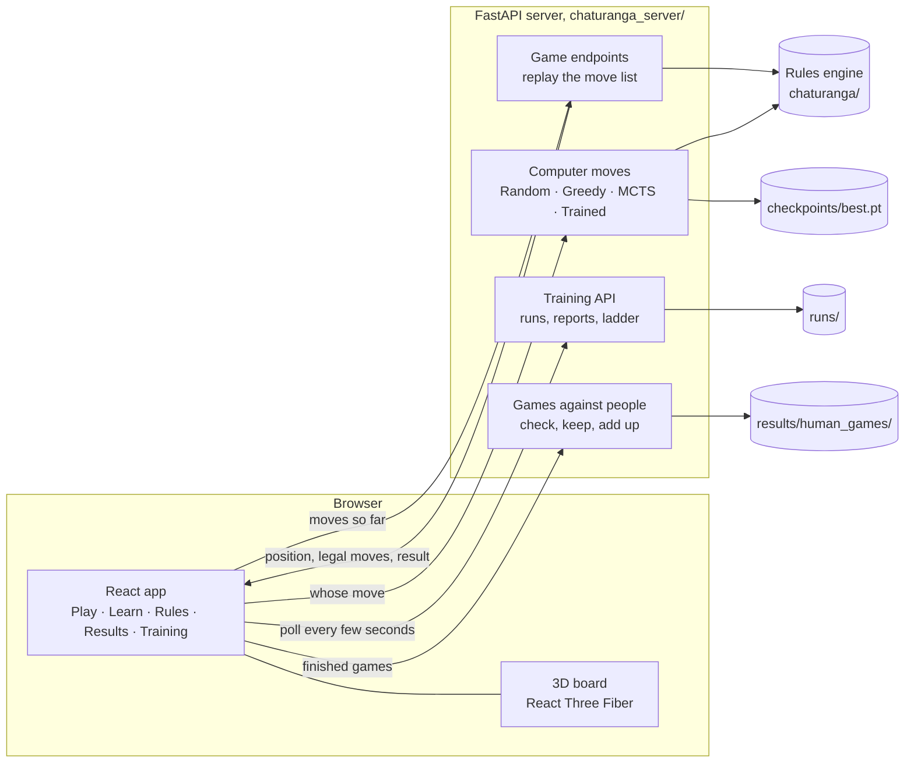
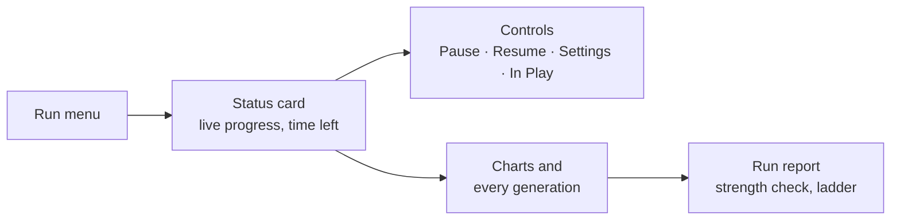

# The web app

[← Back to the README](../README.md)

The browser app lives in `web/`: React, TypeScript, Vite, Tailwind CSS, and React Three Fiber for
the 3D board. **It never implements the rules itself.** Every move goes to the FastAPI server in
`chaturanga_server/`, which replays the game with the Python engine and returns the position, the
legal moves and the result. The server keeps no game state, so undo and review are just shorter
move lists.

## Running it

| | Commands | Then open |
|---|---|---|
| **Development** (hot reload, two terminals) | `python -m chaturanga_server --reload` and `npm run dev --prefix web` | http://localhost:5173 (it forwards `/api` to port 8000) |
| **Demo** (one server) | `npm run build --prefix web` once, then `python -m chaturanga_server` | http://127.0.0.1:8000 |

## Screens

### Play

The board fills the screen, and a floating card shows whose turn it is.

- **Modes:** two players (the board turns to face the player to move), against the computer
  (Random, Greedy, MCTS or Trained, the trained agent at Easy, Medium, Hard or Impossible), or
  computer against computer with a pace control, which waits for **Start** and can be paused.
- **Game drawer** (the toolbar's **Game**; Esc closes it): the mode, the move list (click to review),
  captured pieces, display options (including Reduced graphics) and Rotate. **Details** switches
  between *Essential* (headlines only) and *Full*, with toggles for move hints, move counters, why
  the game ended, and rule sources.
- **Recording** (against the computer): **Record**, in the quick actions or the Game drawer, saves
  each finished game for the Results page: its moves and result, nothing about the player. The
  status card shows *Recording*. Once you have moved in a recorded game, its mode, colour and
  opponent are locked, and a new game before its end counts as resigning it.
- **Quick actions** (the ‹ button): Undo (or Start / Pause against computers), Record and Resign
  against the computer, Full screen and New game.
- **Review:** a bar at the foot of the board steps through the moves (⏮ ◀ ▶ ⏭, or ← → Home End)
  and replays the game at three speeds; stepping back plays the move in reverse, captured pieces
  returning from their tray.

### Learn

11 lessons: the board, each piece, check and checkmate, bare king, stalemate and draws. Most end with
a one-move task that the engine checks. **Lessons** opens the list and **Lesson** the text; the ‹
button resets the board and moves between lessons. `tests/test_lessons.py` checks that every lesson
position is legal and every task can be solved.

### Rules

A compact reference: setup, the pieces and how a game ends. The sources behind each rule are in
[RULES.md](RULES.md).

### Results

The games people played against the computer, with recording on
([details](HUMAN_GAMES.md)):

- **The trained opponent:** whether Play's network is the Milestone 4 agent, recognised by its
  file's sha256. A laptop without one is shown how to load it: download it from the release, then
  **Load network file**.
- **Results:** wins, draws and losses for the people against each opponent, level and network.
- **Games:** every recorded game, the most recently added first, with **Replay**, which plays it on
  the board.
- **Collect everyone's games:** **Export games** writes one file to send; **Import files** adds the
  files teammates sent, each game replayed and checked, and any already there skipped.

### Training

Follows the training runs in `runs/`, live:

- **New run** starts training on this Mac, Colab, Kaggle or your own server
  ([details](TRAINING_REMOTE.md)); **Delete** removes a run that is not training.
- **The status card** shows what the run is doing (self-play, training, tests or its report) with
  the games and moves as they happen, a bar that fills smoothly, and the time left.
- **In Play** chooses which of the run's networks the Trained opponent uses.
- **The Run report** makes a report on request, with the strength check and the rating ladder
  ([details](TRAINING.md#the-run-report)).

## Camera, accessibility and speed

<b>Camera</b>

Drag to orbit the board. Zoom with the mouse wheel, a two-finger scroll, a trackpad pinch, or a
two-finger pinch on a touch screen.

<b>Accessibility</b>

- The board can be played by keyboard: arrow keys move a cursor, Enter selects and moves, Escape
  cancels.
- Highlights differ in shape as well as colour, so they don't rely on colour alone.
- Reduced-motion settings are respected.
- Light and dark themes follow the system setting, with a toggle in the top bar.

<b>Performance on slower machines</b>

- **On-demand rendering:** the 3D scene draws only when something changes, so it uses no GPU while
  you think.
- **Reduced graphics** (a switch in the Game drawer): no shadows, glossy finishes or pulsing check
  ring, at a pixel ratio of 1. Machines with 4 or fewer cores, or 4 GB of memory or less, start with
  it on.
- **Few draw calls:** each carved piece is merged into one mesh per material, and shadows are redrawn
  only when a piece moves.
- **Cheap theme switching:** the page crossfades on the GPU (View Transitions API), and the set of
  lights never changes, so shaders never recompile.

<b>Developer aids</b> (development builds only)

- `?showcase` shows every piece model side by side; `?showcase&kind=3` shows one up close (kinds
  1–6: Padati, Ashva, Gaja, Ratha, Mantri, Raja).
- `window.__game` exposes the Play store in the browser console.

Design intent and audience are in [PRODUCT.md](../PRODUCT.md).
